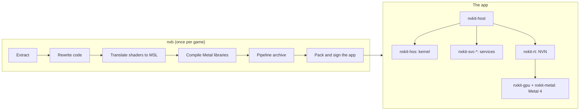

# nxkit

nxkit runs Switch and Switch 2 games natively on the Mac. It is a Rust monorepo with two parts:

- **The build tool `nxb`.** It changes a game package that you own into a Mac app. It extracts the game data, rewrites the
  game code for the Mac, translates the shaders to Metal, compiles them and makes the pipeline archive, and packs and signs the app.
- **The runtime.** The app runs the game code on the CPU as it is. The runtime gives the game what the console gives it:
  a Horizon kernel, the system services and an NVN graphics driver on Metal 4.

Use nxkit only with games that you own. No game data, keys or shaders are in this repository.

## Status

The current release is [0.10.3](https://github.com/v0lumehi/nxkit/releases/tag/v0.10.3) (2026-11-19). It is early
software. The apps run on Macs with Apple silicon. The libraries are built for the Mac's own macOS version, so on
macOS 26 build the app on macOS 26. The release ZIP holds `nxb` and `nxkit-host` for macOS 26 and newer (see "Install a release"). `nxb` also builds on Windows (x86-64), where `nxb extract` runs.

A game runs on the runtime when it has a title module in `titles/games/`. There are 154, one for each game of the engine
tree. A title module holds what is specific to one game: its memory layout, thread roles, settings and code rules.
Everything else is general. Refer to [docs/titles.md](docs/titles.md). For a game without a title module,
`nxb build --auto-analyze` reads the module order, build IDs and settings from the game files (experimental).
The [CHANGELOG](CHANGELOG.md) lists every change.

## How it works



- **The game code runs natively.** Switch games are AArch64 code, as the Mac is. `nxb` rewrites the parts that cannot run
  as they are (system calls, thread-local storage) and links the modules into one `nxgame.dylib` at the fixed addresses of the console.
- **The shaders are translated once, at build time.** The games ship NVIDIA machine code (Maxwell and Ampere). `nxb-xlate`
  translates it to MSL, and the pipeline archive holds a base for every shader pair. The host specializes a base for a colour state without a compile, and keeps the pipelines it made, so a start makes them before the first frame and nothing is rebuilt after playing.
- **A small kernel of its own.** `nxkit-hos` gives each guest thread a host thread. Locks, condition variables and address
  waits use `os_sync_wait_on_address`, without a global lock. A thread's QoS class follows its role in the game.
- **Services at SDK level.** The `nxkit-svc-*` crates answer the SDK functions and the IPC services that the games call:
  file system and saves, audio, input (GameController, keyboard, mouse, rumble), video decoding (VP9 and AV1; AV1 in
  hardware on M3 and newer), system settings and frame pacing.
- **NVN on Metal 4.** `nxkit-rt` implements the NVN API. `nxkit-nvn` reads the game's command buffers into frames,
  `nxkit-gpu` turns them into Metal passes, and `nxkit-metal` is the Metal 4 backend.
- **Native replacements of neural networks.** Where a game runs a network as compute dispatches (the movie upscaler
  and the in-game upscaler of some titles), `nxkit-gpu` runs own kernels, and the movie network can run on the Neural Engine
  (`nxkit-coreml`, `nxkit-ndve`, `nxkit-ndsr`). If anything does not match, the game's own dispatches run.
- **No game knowledge in the core.** Everything that is specific to one game is data in `titles/`: engine families,
  title modules, memory layout, thread roles and settings. Refer to [docs/titles.md](docs/titles.md).

## Build from source

You need Rust 1.99 or newer and Xcode with its command line tools.

```sh
cargo build --release -p nxb-cli -p nxkit-host
```

The programs are `target/release/nxb` and `target/release/nxkit-host`. `nxb` finds `nxkit-host` in its own folder, or
in `NXB_NXKIT_HOST`. The release programs are built with `cargo build --profile dist` (fat LTO).
`tools/check.sh` runs the formatter, the lints, the tests, the documentation and the layer and size checks.

## Install a release

The ZIP of a release, `nxb-vX.Y.Z-macos-arm64.zip`, holds both programs, so you need no Rust to build a game. Check it
against `SHA256SUMS` of the release, then unpack it:

```sh
shasum -a 256 -c SHA256SUMS --ignore-missing
unzip nxb-vX.Y.Z-macos-arm64.zip
```

The folder `nxb-vX.Y.Z-macos-arm64` holds `nxb`, `nxkit-host` (keep them in one folder), `MANIFEST.json`, `LICENSE` and
`THIRD_PARTY.md`. `MANIFEST.json` names the version, the platform, `macos_min` and the SHA-256 of the two programs.
`SHA256SUMS` lists the ZIP and each file in it. The programs have an ad-hoc signature. A file that you download in a
browser carries the quarantine flag, so run `xattr -dr com.apple.quarantine <folder>` once.

The release is for Macs with Apple silicon and macOS 26 or newer (`macos_min` is 26.0), because the host uses Metal 4.
The programs are built with that deployment target, so an older macOS refuses to start them. There is one build for all
supported versions. The shaders and the pipeline archives come from the Metal tools of your own Xcode when `nxb build`
runs, so you still need Xcode on the Mac that builds the app.

## Verify a release

Each release has `SHA256SUMS.sig`. It is a detached Ed25519 signature of the exact bytes of `SHA256SUMS`, in base64 on one line.
The public key is in `release-signing.pub`. Download `SHA256SUMS` and `SHA256SUMS.sig` into one folder, then run:

```sh
python3 -m pip install -r tools/requirements-release.txt
python3 -I tools/release-sign.py verify SHA256SUMS --pub release-signing.pub
```

Then check the ZIP against `SHA256SUMS` as shown above. Front ends that update nxkit by themselves do the same two checks.

The `format` field of `MANIFEST.json` changes only when the layout of the ZIP changes, because front ends check it.

## Build a game

```sh
nxb build "<folder with the game files>" -k <prod.keys> --platform mac \
  -o "$HOME/Games/<Game>.app" --work-dir "$HOME/Games/<game>-work"
```

- `--dry-run` prints the plan and writes nothing. Check it first.
- A Switch 2 package needs `--nup <file>` and no keys.
- `nxb` builds only nxkit apps, with `nxkit-host` as their program. A game without a title module needs
  `--auto-analyze`. There is no iOS build, no `--engine` and no Python.
- Ocarina of Time can keep a fixed render scale: `--resource-patch resolution-scale=<0..1>`.
- The work folder takes many GB. A second build with the same files reuses the finished stages. After a change of the
  translator, only the shaders whose MSL changed compile again (refer to [docs/early-cutoff.md](docs/early-cutoff.md)).
- `--progress bar` shows one live line with the stage, a bar and the time left.

The step-by-step guide for one game is [docs/build-botw.md](docs/build-botw.md).
Run `nxb help` for all commands and `nxb help build` for all options.

## Run a game

Open the app in Finder, or start it from a terminal to see its log:

```sh
"<Game>.app/Contents/MacOS/nxkit-host" "<Game>.app/Contents/Resources/nxkit"
```

`NXKIT_SCREEN=<name or index>` picks the screen for the window. [docs/pacing.md](docs/pacing.md)
explains the frame pacing, and [docs/diagnostics.md](docs/diagnostics.md) lists the diagnostics (`NXKIT_DIAG`) and knobs.

## Repository layout

| path | content |
|---|---|
| `crates/nxb-*` | the build tool: extract, split, rewrite, shader translator and compile, pipeline archive, bundle, signer |
| `crates/msl-*`, `crates/air-*`, `airc`, `mslcheck` | the own MSL to AIR front end, which makes Metal libraries without Apple's `metal` |
| `crates/nxkit-*` | the runtime: host, kernel, IPC, services, NVN, GPU, Metal 4 backend |
| `titles/` | engine families and title modules |
| `docs/` | the documentation. The index is [docs/README.md](docs/README.md) |
| `xtask/` | developer tools, among them the layer check (`cargo run -p xtask -- layers`) |

The crates are in layers, and dependencies point down only. Only a few modules hold `unsafe` code, all named in
[docs/architecture.md](docs/architecture.md).

## Contributing and security

Read [CONTRIBUTING.md](CONTRIBUTING.md) before you open a pull request. To report a security problem, read [SECURITY.md](SECURITY.md).

## License

MIT. See [LICENSE](LICENSE). Releases 0.9.3 to 0.10.0 were published under GPL-3.0-only. Notes about formats, external
tools and third-party code are in [THIRD_PARTY.md](THIRD_PARTY.md).
