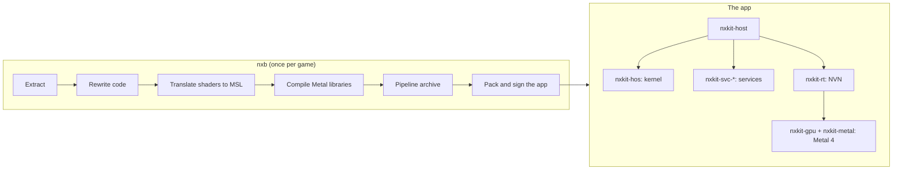

# nxkit

nxkit runs Switch and Switch 2 games natively on the Mac. It is a Rust monorepo with two parts:

- **The build tool `nxb`.** It changes a game package that you own into a Mac app. It extracts the game data, rewrites the
  game code for the Mac, translates the shaders to Metal, compiles them and makes the pipeline archive, and packs and signs the app.
- **The runtime.** The app runs the game code on the CPU as it is. The runtime gives the game what the console gives it:
  a Horizon kernel, the system services and an NVN graphics driver on Metal 4.

Use nxkit only with games that you own. No game data, keys or shaders are in this repository.

## Status

Version 0.10.0 is not released yet. It is early software. Mac on Apple silicon only.

A game runs on the runtime only when it has a title module in `titles/games/`. A title module holds what is specific
to one game: its memory layout, thread roles, settings and code rules. Everything else is general. Refer to
[docs/titles.md](docs/titles.md). The [CHANGELOG](CHANGELOG.md) lists every change.

## How it works



- **The game code runs natively.** Switch games are AArch64 code, as the Mac is. `nxb` rewrites the parts that cannot run
  as they are (system calls, thread-local storage) and links the modules into one `nxgame.dylib` at the fixed addresses of the console.
- **The shaders are translated once, at build time.** The games ship NVIDIA machine code (Maxwell and Ampere). `nxb-xlate`
  translates it to MSL, and the pipeline archive holds a base for every shader pair. The host specializes a base for a colour state without a compile, and keeps the pipelines it made, so a start makes them before the first frame and nothing is rebuilt after playing.
- **A small kernel of its own.** `nxkit-hos` gives each guest thread a host thread. Locks, condition variables and address
  waits use `os_sync_wait_on_address`, without a global lock. A thread's QoS class follows its role in the game.
- **Services at SDK level.** The `nxkit-svc-*` crates answer the SDK functions and the IPC services that the games call:
  file system and saves, audio, input (GameController, keyboard, mouse, rumble), video decoding (VP9 and AV1; AV1 in
  hardware on M3 and newer), system settings and frame pacing.
- **NVN on Metal 4.** `nxkit-rt` implements the NVN API. `nxkit-nvn` reads the game's command buffers into frames,
  `nxkit-gpu` turns them into Metal passes, and `nxkit-metal` is the Metal 4 backend.
- **Native replacements of neural networks.** Where a game runs a network as compute dispatches (the movie upscaler
  and the in-game upscaler of some titles), `nxkit-gpu` runs own kernels, and the movie network can run on the Neural Engine
  (`nxkit-coreml`, `nxkit-ndve`, `nxkit-ndsr`). If anything does not match, the game's own dispatches run.
- **No game knowledge in the core.** Everything that is specific to one game is data in `titles/`: engine families,
  title modules, memory layout, thread roles and settings. Refer to [docs/titles.md](docs/titles.md).

## Build from source

You need Rust 1.99 or newer and Xcode with its command line tools.

```sh
cargo build --release -p nxb-cli -p nxkit-host
```

The programs are `target/release/nxb` and `target/release/nxkit-host`. `nxb` finds `nxkit-host` in its own folder.
`tools/check.sh` runs the formatter, the lints, the tests, the documentation and the layer and size checks.

## Build a game

```sh
nxb build "<folder with the game files>" -k <prod.keys> --platform mac \
  -o "$HOME/Games/<Game>.app" --work-dir "$HOME/Games/<game>-work"
```

- `--dry-run` prints the plan and writes nothing. Check it first.
- A Switch 2 package needs `--nup <file>` and no keys.
- `nxb` builds only nxkit apps: a game that has a title module, into an app with `nxkit-host` as its program. There is no
  iOS build, no `--engine` and no Python.
- The work folder takes many GB. A second build with the same files reuses the finished stages. After a change of the
  translator, only the shaders whose MSL changed compile again (refer to [docs/early-cutoff.md](docs/early-cutoff.md)).
- `--progress bar` shows one live line with the stage, a bar and the time left.

The step-by-step guide for one game is [docs/build-botw.md](docs/build-botw.md).
Run `nxb help` for all commands and `nxb help build` for all options.

## Run a game

Open the app in Finder, or start it from a terminal to see its log:

```sh
"<Game>.app/Contents/MacOS/nxkit-host" "<Game>.app/Contents/Resources/nxkit"
```

`NXKIT_SCREEN=<name or index>` picks the screen for the window. [docs/pacing.md](docs/pacing.md)
explains the frame pacing, and [docs/diagnostics.md](docs/diagnostics.md) lists the diagnostics (`NXKIT_DIAG`) and knobs.

## Repository layout

| path | content |
|---|---|
| `crates/nxb-*` | the build tool: extract, split, rewrite, shader translator and compile, pipeline archive, bundle, signer |
| `crates/msl-*`, `crates/air-*`, `airc`, `mslcheck` | the own MSL to AIR front end, which makes Metal libraries without Apple's `metal` |
| `crates/nxkit-*` | the runtime: host, kernel, IPC, services, NVN, GPU, Metal 4 backend |
| `titles/` | engine families and title modules |
| `docs/` | the documentation. The index is [docs/README.md](docs/README.md) |
| `xtask/` | developer tools, among them the layer check (`cargo run -p xtask -- layers`) |

The crates are in layers, and dependencies point down only. Only a few modules hold `unsafe` code, all named in
[docs/architecture.md](docs/architecture.md).

## Contributing and security

Read [CONTRIBUTING.md](CONTRIBUTING.md) before you open a pull request. To report a security problem, read [SECURITY.md](SECURITY.md).

## License

GPL-3.0-only. See [LICENSE](LICENSE). Anyone may use nxkit. Whoever passes on a changed version must publish its source
under the same license. Releases up to 0.9.2 were published under MIT and stay under MIT. Notes about formats, external
tools and third-party code are in [THIRD_PARTY.md](THIRD_PARTY.md).

## WebAssembly libraries

The byte-based `nxb-rewrite`, `nxb-split`, `nxb-romfs`, `nxb-xlate`, and `air-front`
libraries build for `wasm32-unknown-unknown` with Rust 1.99. `nxb-extract` exposes
its parsers and storage views with `--no-default-features`. Its default `host`
feature enables file extraction and timing. Native zlib is not available on WebAssembly.
The caller provides WebAssembly exports and input budgets. Native extraction,
app execution, signing and IPA packaging are not ported by this change.
