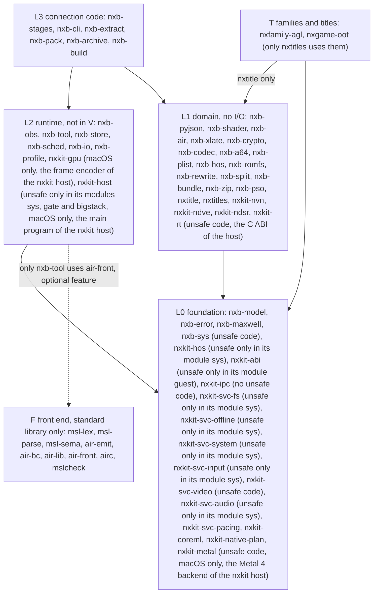
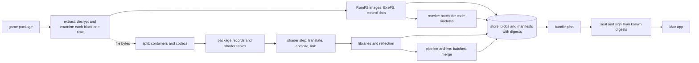

# Architecture overview

This document gives the structure of the workspace: the layers, the crates and the data flow between the stages.
For the decisions behind this structure, refer to [decisions.md](decisions.md).

## Workspace

- The repository is one Cargo workspace. The crates of the build are in `crates/`. The families and title modules are in `titles/` (refer to [titles.md](titles.md)). The developer tools are in `xtask/`.
- Each crate has the name `nxb-<concern>`. The front-end crates of layer F keep their names (`msl-*`, `air-*`, `airc`, `mslcheck`).
- `nxb-cli` makes the one program, `nxb`. Each stage is a command of `nxb`: `build`, `extract`, `split`, `shaders`, `sign`, `pso`, `archive` and `airc`. The other commands are `cache`, `prune`, `regressions`, `self-check` and `version`. The stage crates are libraries, and `nxb-cli` calls them. The stages have no other program and no dispatch by the program name. The front-end crates `airc` and `mslcheck` also build their own programs.
- The workspace uses the standard library only, with one exception. `nxkit-metal`, `nxkit-svc-input` and `nxkit-host` use the `objc2` family of crates to bind Metal, GameController, Core Haptics and AppKit on macOS. `deps.toml` lists them.

## Layers

A crate can use only crates of a lower layer, plus the sideways edges in the table below. The command
`cargo run -p xtask -- layers` makes sure that the crate graph obeys these rules. It reads the layer from
`[package.metadata.nxb]` in each `Cargo.toml`.

The rules:

1. L0 holds the identifiers, the digests, the error classes and the system calls.
2. L1 does no I/O. Its crates are pure functions over bytes and text that return `Result`. L1 can call `nxb-sys` only for pure calculations.
3. L2 runs tasks, keeps blobs, starts child processes and writes events. `nxb-tool` also wraps the Metal tools and the shader front ends.
4. L2 does not make output bytes of the shader step.
5. Only `nxb-sys`, `nxkit-rt`, `nxkit-metal`, `nxkit-svc-video`, the module `sys` of `nxkit-hos`, of `nxkit-svc-fs`, of `nxkit-svc-offline`, of `nxkit-svc-system`, of `nxkit-svc-input` and of `nxkit-svc-audio`, the modules `sys`, `gate` and `bigstack` of `nxkit-host`, and the module `guest` of `nxkit-abi` contain `unsafe` code. The reason in `nxkit-host` is calls into libc, dyld, Mach and AppKit in `sys`, and the assembly of the svc gate, the thread entry and the big-stack entry in `gate` and `bigstack`. All other crates forbid `unsafe_code` in the lint settings of their `Cargo.toml`.
6. L3 connects the stages. One stage module has a maximum of 400 lines.
7. The development crates (`nxb-testkit`, `xtask`) are dev-dependencies only.
8. Layer F uses no `nxb-*` crate. Only `nxb-tool` can use `air-front`, and only `nxb-cli` can use `airc`. Both are behind the cargo feature `air-front`.
9. Layer T holds the families and title modules. A `T` crate uses only `nxtitle` and L0. Only `nxtitles` uses a `T` crate.

### Sideways edges

| from | to | cause |
|---|---|---|
| nxb-error | nxb-model | the identifiers in the error types |
| nxb-model | nxb-sys | ARMv8 SHA-256 instructions. The digests do not change (W17). |
| nxb-air | nxb-shader | declared for the in-process front end (W18, skeleton) |
| nxb-shader | nxb-pyjson | the JSON files of the shader step |
| nxb-hos | nxb-romfs, nxb-crypto, nxb-codec | the NCA data section is a RomFS, AES, NCZ blocks |
| nxb-romfs | nxb-crypto | the `romfs.id` digests |
| nxb-rewrite | nxb-a64, nxb-codec | the AArch64 decoder, LZ4 segments of NSO files |
| nxb-split | nxb-codec, nxb-romfs | decompression, the walk through the image |
| nxb-bundle | nxb-plist | `Info.plist` |
| nxb-zip | nxb-codec | deflate |
| nxb-xlate | nxb-pyjson | the job file and the JSON of the reflection |
| nxb-pso | nxb-pyjson | tables and stamps |
| nxb-cli, nxb-build | nxb-extract, nxb-pack, nxb-archive | the L3 stage crates (W19) |
| nxb-cli | nxb-build | the `nxb build` orchestrator (W19) |
| nxb-cli | nxb-stages | the shader step of `nxb shaders build` |
| nxb-build | nxb-stages | the shader step in the build graph (W19) |
| nxtitles | nxtitle | the registry builds the catalog of the title API |
| nxkit-hos, nxkit-ipc, nxkit-svc-* | nxkit-abi | the guest ABI that the kernel, the IPC server and the services share |
| nxkit-rt | nxkit-nvn | the NVN C functions over the front end |

## Crates

"V" means that the crate has `in_v = true` in `[package.metadata.nxb]`. The layer check makes sure that such a crate uses only crates with V. The chain version V itself is a hash of the host's shader chain files, plus the options string `debug=True reduced=True`. No Rust source goes into V.
"impl" means that the crate has a full implementation. "skel" means that the crate compiles, but has stubs with documentation only.

| crate | layer | V | state | function |
|---|---|---|---|---|
| nxb-model | L0 | yes | impl | identifiers (`ShaderKey`, `TitleId`, `Target`, `StageId`), `Digest`, own SHA-256, `ContentKey`, `HashingWriter` |
| nxb-error | L0 | yes | impl | error classes, reason strings, `BuildError`, `EnvError` with errno classes |
| nxb-sys | L0 | no | impl | process groups, memory size, core counts, locks, clonefile, zlib, AES, SHA instructions |
| nxb-maxwell | L0 | yes | impl | decoders for Maxwell and Ampere (sm_86) machine code of the game GPU |
| nxb-pyjson | L1 | yes | impl | a JSON writer that gives the same bytes as Python `json.dumps`. Measured: byte-identical on 16,269 JSON files of the reference title. |
| nxb-shader | L1 | yes | impl | the job writer, the chain version, guards, the header, the target conventions, the side library cut |
| nxb-air | L1 | yes | skel | the in-process front end (planned, W18) |
| nxb-xlate | L1 | yes | impl | the Rust translator: decode, control flow, SSA, passes, structured IR and MSL with a typed `Reflection` (`nxb_xlate::msl::translate`). Refer to [translator.md](translator.md) |
| nxb-a64 | L1 | no | impl | an AArch64 decoder and the encoders for the rewrite step. It follows Capstone 5 for the fields that the rewriter uses |
| nxb-rewrite | L1 | no | impl | the code rewrite: NSO and NRO load, rules as data, the five tables |
| nxb-codec | L1 | no | impl | the ZBIC decoder (`nxb_codec::zbic`). The other codec modules are empty. |
| nxb-crypto, nxb-plist, nxb-hos, nxb-romfs, nxb-bundle, nxb-zip, nxb-pso | L1 | no | skel | pure domain logic. Some of it is in the stage crates at this time. |
| nxb-split | L1 | no | impl | containers, shader keys, package records and tables. It supports many container families (refer to [pipeline-stages.md](pipeline-stages.md)). Formats that are not ported stop with a named `Unsupported` error and exit code 4. |
| nxkit-hos | L0 | no | impl | the Horizon kernel: objects, handles, events, threads, `WaitSynchronization`, the lock, condition variable and address arbiters, the process memory and its svcs, IPC sessions and the SDK take-overs of the kernel side. Guest memory and the host's pages sit behind traits, so the crate has no `unsafe` code outside `sys`. Refer to [nxkit-hos.md](nxkit-hos.md). It uses `nxkit-abi` and the standard library |
| nxkit-ipc | L0 | no | impl | the IPC server of the nxkit host: HIPC and CMIF parsing, domains, the service manager `sm:`, per-command counters and the stop on an unknown command. No `unsafe` code, no global lock on the request path |
| nxkit-svc-fs | L0 | no | impl | the `fs` service: `fsp-srv` and its interfaces over IPC, the SDK-level `nn::fs` functions, the romfs through `mmap` and the save layout. `unsafe` only in `sys` (`mmap`, `pread`, `clonefile`, `renamex_np`) |
| nxkit-svc-offline | L0 | no | impl | the `offline` service: the answers for networking and peripherals the game cannot use here. `unsafe` only in `sys` |
| nxkit-svc-video | L0 | no | impl | the `video` service: `movie::Decoder` and `nn::codec` video decoders for VP9 on VideoToolbox and AV1 on VideoToolbox (M3 and newer) or rav1d (software), with `CVPixelBuffer` frames and a `CVMetalTextureCache` path. Source only, not yet compiled or run |
| nxkit-svc-input | L0 | no | impl | the `input` service: controllers, GameController and Core Haptics through `objc2`. `unsafe` only in `sys` |
| nxkit-svc-audio | L0 | no | impl | the audio service of the nxkit host: SDK take-overs, `audout:u`, `audren:u`, `IAudioDevice`, and a mixer in the AUHAL callback (R41, R42). It is not compiled or tested yet |
| nxkit-svc-pacing | L0 | no | impl | the `pacing` service: the `Pacer` for present intervals and the frame pace profile |
| nxkit-native-plan | L0 | no | impl | the native passes as data (`Plan`, `Step`, `GameResource`, `Binding`), shared by the networks that `nxkit-gpu` runs natively. No Metal code |
| nxkit-ndve | L1 | no | impl | the movie network of `nn::ndve` run natively: file reader, weight packing, the plan and Metal kernels, and the `ane` module that writes the Core ML model for the Neural Engine. Refer to [plans/ndve-native.md](plans/ndve-native.md) |
| nxkit-ndsr | L1 | no | impl | the agl upscaler NDSR run natively: network table and fingerprint of the packs `vr` and `vr_light`, pack reader, CPU reference, kernels and plan. Refer to [plans/ndsr-native.md](plans/ndsr-native.md) |
| nxkit-coreml | L0 | no | impl | Core ML on the Neural Engine over IOSurface tensors (`objc2-core-ml`). It knows nothing about the network. Refer to [plans/ndve-ane.md](plans/ndve-ane.md) |
| nxkit-host | L2 | no | impl | the main program of the host (`nxkit-host`, plus a library): the guest memory reservation, the loader of `nxgame.dylib`, the svc and TLS gates, the big-stack entry, the game threads and the AppKit window. Its contract with the build stage is [nxkit-host.md](nxkit-host.md). It runs on macOS only. |
| nxkit-svc-system | L0 | no | impl | the system services as `Service` objects: `set`, `set:sys`, `apm`, `time:*`, `acc:*`, `appletOE`, `appletAE`, `pctl*`, `nifm:u`, `friend:u`, `prepo:u`, `lm`, `psm`, `ssl`, `bcat:u` and `aoc:u` (R37), and the SDK exports of the take-overs (R38a). The module `sys` holds the clock, time zone and guest call functions |
| nxb-obs | L2 | no | impl | NDJSON events, sinks and the code table (`code` and `severity`) |
| nxb-profile | L2 | no | impl | the profile of a game as typed data, with a TOML reader and writer. the title modules use it for their `profile.toml` |
| nxb-tool | L2 | no | impl | `Tool` trait, `Invocation`, environment allow list, watchdog, circuit breaker, `FrontEnd` trait |
| nxb-store | L2 | no | impl | content-addressed blobs, keyed entries with manifests, quarantine, cache export and import |
| nxb-sched | L2 | no | impl | work-stealing executor with token and memory budgets, single-flight |
| nxb-io | L2 | no | impl | parallel hashing of files and folders (`hash_files`, `hash_tree`) |
| nxb-stages | L3 | no | impl | the shader step. It calls `nxb-xlate` in the process |
| nxb-cli | L3 | no | impl | the program `nxb` with all commands |
| nxb-extract | L3 | no | impl | extract and fused split for NSP, XCI, NSZ and NUP. The commands are `nxb extract` and `nxb split` |
| nxb-pack | L3 | no | impl | the ad-hoc signer and the staging of a file set into a bundle (`nxb sign`) |
| nxb-archive | L3 | no | impl | the pipeline archive: plan, batches, merge |
| nxb-build | L3 | no | impl | the orchestrator `nxb build`: it builds only games that have a title module, into an app with `nxkit-host` |
| nxkit-nvn | L1 | no | impl | the NVN front end of the nxkit host: GPU addresses, texture layout and descriptors, recording in command memory and render pass inference. Pure Rust, no Metal yet. Refer to [nxkit-nvn.md](nxkit-nvn.md) |
| nxkit-gpu | L2 | no | impl | the frame encoder of the nxkit host, macOS only: it turns a held `nxkit-nvn` frame into Metal 4 work with ICBs for reused recordings, bindless textures, barriers where data flows, tile memory and parallel encoding. No `unsafe` code. Refer to [nxkit-gpu.md](nxkit-gpu.md) |
| nxtitle | L1 | no | impl | the title API: `Family`, `Title`, the hooks, `Fact` and `Evidence`, the `Catalog` that composes them. Refer to [titles.md](titles.md) |
| nxtitles | L1 | no | impl | the registry: one cargo feature per family and title module |
| nxfamily-agl | T | no | impl | the family of Nintendo EPD games on sead, agl and gsys |
| nxgame-oot | T | no | impl | The Legend of Zelda: Ocarina of Time for Nintendo Switch 2 (`0400486024DEC000`) |
| nxb-testkit, nxb-xlatedev, xtask | dev | no | impl | seeded generators, the corpus tool of the Rust translator (`xlate-corpus`), the layer and size checks |
| msl-lex, msl-parse, msl-sema, air-emit, air-bc, air-lib, air-front, airc, mslcheck | F | no | impl | the own front end. Refer to [frontend.md](frontend.md). |

## Data flow of the stages

The arrows show data only. There are no barriers between the stages. The split starts on the first file that the
extract decrypts. The first archive batch starts when its libraries are in the store. Only the seal waits for all data.

## The host at run time: the parts that are not a straight translation

Most of the run time path is a direct image of the Switch: `nxkit-hos` threads, `nxkit-ipc` services, `nxkit-rt` NVN calls, `nxkit-nvn` frames, `nxkit-gpu` Metal 4 work (refer to [nxkit-gpu.md](nxkit-gpu.md)). Six parts do more than that. Each has a detailed plan, and this section gives the shape and the status. A number is marked **measured** (a run on the reference machine, an M2 Max unless said), **derived** or **assumed** (nobody checked it).

### Native replacements of tensor networks

Some games run a neural network as a chain of compute dispatches. `nxkit-gpu` (`native`) can replace such a chain by kernels of its own. The layer knows no network. A `Replacement` says how to find the chain (the program keys of the frame's dispatches), which bound weight buffers prove that it is the known network, and how to build a `Plan` (buffers, kernels, grids, bindings; the types are in `nxkit-native-plan`, with no Metal code). `Native::prepare` reads the weight bytes through the bindings and hashes them once per frame, looks the verdict up in a small LRU cache of plans (`NXKIT_NATIVE_CACHE`, 4), and the pass loop skips the game's dispatches and encodes the plan at the last one. Anything that does not match keeps the game's own dispatches, so the failure mode is the original picture and never a wrong one. `NXKIT_<NAME>=0` turns a network off, `NXKIT_<NAME>_COMPARE=1` runs both on a sampled frame.

- **NDVE** (`nxkit-ndve`): the movie upscaler of `nn::ndve`, a U-Net and a resampler on the 1080p picture. Plan: [ndve-native.md](plans/ndve-native.md), [ndve-impl.md](plans/ndve-impl.md). The GPU kernels take 5.8 ms for the full picture before, 4.9 ms after the fused layers (measured).
- **NDSR** (`nxkit-ndsr`): the in-game upscaler of the agl family. The packs `vr` and `vr_light` hold 15 network programs. Each has a CPU reference that matches the emulated SASS of the game bit for bit, and one Metal kernel. Each input and output size gets its own plan, because the dynamic resolution changes the size every few frames. The kernels are 1.7 to 2.2 times faster than the first version on the full picture (measured). Plan: [ndsr-native.md](plans/ndsr-native.md), [ndsr-impl.md](plans/ndsr-impl.md). The NDVE resampler is an NDSR network.

### The Neural Engine offload of NDVE

The Neural Engine runs the movie network faster than the GPU kernels leave room for. It is on by default; `NXKIT_NDVE_ANE=0` keeps NDVE on the GPU. Plan: [ndve-ane.md](plans/ndve-ane.md).

- `nxkit-coreml` loads a Core ML ML Program with `cpuAndNeuralEngine` and runs it over IOSurface tensors. It knows nothing about the network. `nxkit-metal` wraps an IOSurface as a texture. A model that is not all on the Neural Engine (`compute_plan`) is refused.
- The `ane` module of `nxkit-ndve` writes the `.mlpackage` from the weight blob in Rust (no Python at run time). The model leaves the quantise, the bilinear sample and the dither to a GPU epilogue (`ndve_ane_quant`, `ndve_ane_epilogue`). The package and the compiled model are cached by the weights and the macOS build.
- The picture is fed at decode time. `nxkit-svc-video` reports every decoded picture and the guest memory the game reads it into; a feeder converts it to the f16 input on the CPU (2 to 3 ms, measured in the study) and starts the prediction, three pictures ahead of the game. The first wiring, where the game's frame wrote the input and the result came one picture later, never had a result in time (1095 of 1101 pictures late, measured) and is gone.
- The game's dispatch finds its picture in three ways: the address of the read, the chain of the game's copies back to that address, and a luma fingerprint. A stream with 30 dispatches in a row that match nothing is given up. A dispatch without a ready result runs the Metal plan (`ndve.ane_fallback(reason)`).
- Status: the wiring has unit tests without Metal or Core ML. The study measured about 9 ms for the model on the Neural Engine; whether every picture is early enough in a game is read from the health counters and the `ndvetrace` report, not assumed.

### The movie path

AV1 movies decode on the CPU with rav1d on a worker thread of the stream (all cores up to 16, two frames in flight), or in hardware with VideoToolbox on M3 and newer. `Submit` only queues the packet. The worker is at most three pictures ahead of the game and never drains the decoder before the end of the stream, because a drain in the middle of a stream waited for ever with more than one frame in flight. An 8-bit 4:2:0 picture becomes NV12 by rows. Each picture has its own timestamp and an id for the Neural Engine feeder.

### The pipeline path, end to end

Details: [shader-step.md](shader-step.md), [plans/pipelines-at-build-time.md](plans/pipelines-at-build-time.md), [plans/pipeline-prewarm.md](plans/pipeline-prewarm.md).

1. **Build.** `nxb-xlate` translates the shader to MSL, the own front end or Apple's tools make the Metal library, and `nxb-archive` plans the pipeline archive: one unspecialized base for each shader pair. A vertex shader with stage inputs has a second library, `_bp`, that reads its streams itself (vertex pulling). The plan archives the `_bp` function, so its base has no vertex layout.
2. **Keys.** Batches are content keys. A translator change that touches only the shaders of one feature (now `hmma`) raises that feature's revision and not `TRANSLATOR_ID`; the crate version is in no key. A rebuild redoes only what changed.
3. **Shards.** Each batch is one `.mtl4archive` file under `pipelines/` with an index (`index.nxpi`). `MTL4Archive` read one merged file whole into memory (4.8 GB for one title, measured), so the host opens a shard when its first pipeline is asked for and keeps at most 32 open.
4. **Host.** For a draw `Pipelines` looks the pipeline up in the shards and the runtime archives. A miss takes the base of the pair and specializes it for the colour state with Metal 4 (`cache/specialize.rs`), on background threads (half the cores, 2 to 8, user-initiated QoS, the jobs of the latest frame first). The draw is left out until its pipeline is ready (`skip.pending`).
5. **Runtime cache.** Every pipeline the host makes is captured into `rt-*.mtl4archive` files with a list (`pipelines.seen`) beside the title. At the next start the host makes the pipelines of the list before the first frame (budget 20 s). The user does not rebuild after playing.
6. **Vertex pulling.** With `_bp` the draw binds a `dm_vlayout` block at buffer 16 and the pipeline has no vertex layout, so one base serves every layout. `NXKIT_PULL=0` keeps `stage_in`.

Status: specialization, background builds, the runtime cache and the pull path are built. The archive served 21 % of the shader pairs of one title before the pull path (derived from the plan counts); the plan expects 96 % with it, **assumed until measured in a game**. Building every pipeline at build time (recorded states, a fetch-blend fallback) is a plan.

### Memory

- **The guest range** is one reservation of address space that is also one no-copy `MTLBuffer`. Its whole length counts in the Metal device total (and in the Metal HUD), touched or not. While the buffer is resident the GPU driver wires every page of it, touched or not, outside `phys_footprint`: about 12.4 GiB of wired RAM per run for the 12.5 GiB split of the first title (measured 2026-11-09, `docs/nxkit-host.md`, "What the GPU buffer costs"). The size of the heap and alias regions is therefore RAM; the host prints the game's peak use of them at the end of a run, and the title's `memory` profile sets them. Inside the buffer the kernel never puts other pages under the GPU (`nxkit_hos::pinned`): it zeroes in place and copies instead of remapping. `NXKIT_MEM_REPORT` counts the mapped, resident, dirty, compressed and wired pages per page.
- **Textures** have a Metal copy and the guest copy. The Metal copy of a texture that no frame used for 600 frames (`NXKIT_TEX_EVICT`) is dropped when the guest copy is current, and made again when the game uses it. A render target, a texture a frame wrote, one the CPU reads back and a memoryless, widened or scaled texture stay.
- **Pipeline archives** are heap while open: the shards, at most 32 (`NXKIT_SHARD_LRU`). The open shards close when the prewarm is over (`NXKIT_SHARD_TRIM=0` keeps them), because idle they are the first memory macOS compresses (1.1 to 1.6 GB measured with 34 to 38 archives open). Shader libraries stay loaded (`docs/nxkit-gpu.md`, "Memory").
- **Caches are bounded:** native plans (4), batch scratch (8 MiB per slot, doubling up to 64 MiB), pooled staging buffers for compressed uploads.
- `NXKIT_MEM_ALLOC=<MiB>` names who makes a large heap allocation.

### Pacing

Details: [pacing.md](pacing.md). The frame step is load-driven: it holds a frame for a number of vsyncs of 1/60 s from the cost of the frames. The profile (`pace_profile` in `game.json`) says how: `hold` (a late frame may stay longer, thermal cap on), `work` (a frame is judged by its work only) and `steady` (the step never leaves the cap's frame rate; a long frame shows late once and the game pays the time back). The variable step, which follows the measured time between shown frames, runs only under variable refresh (VRR) on an adaptive screen. A fixed screen keeps the load-driven step at 60 and a grid of ticks. VRR has not run on a screen yet (tests only).

Measured (`pacing.md`): the GPU lowers its clock when a paced frame leaves it idle (DVFS), so the GPU time in ms of the same work rises when the load per frame falls. Compare GPU times only at equal pacing, and do not read a rise in `NXKIT_PACE_DIAG` GPU ms after a speed-up as a loss.

## Store format and API stability

Each store key has a stage version and the content hash of the stage inputs. Only the translator key `nxb.xlate.v2` contains the chain version V (W21, [early-cutoff.md](early-cutoff.md)).

The store format 1 has these folders: `blobs/<2 hex>/<64 hex>`, `entries/<2 hex>/<64 hex>.manifest`, `quarantine/`, `tmp/`, `dirty/`.
A manifest is text with sorted names and a checksum line.

The API of the shared crates (`nxb-model`, `nxb-error`, `nxb-tool`, `nxb-store`, `nxb-sched`, `nxb-obs`) does not change in one primary version of the workspace. A change that breaks the API is a separate
commit with a note in `CHANGELOG.md`.
