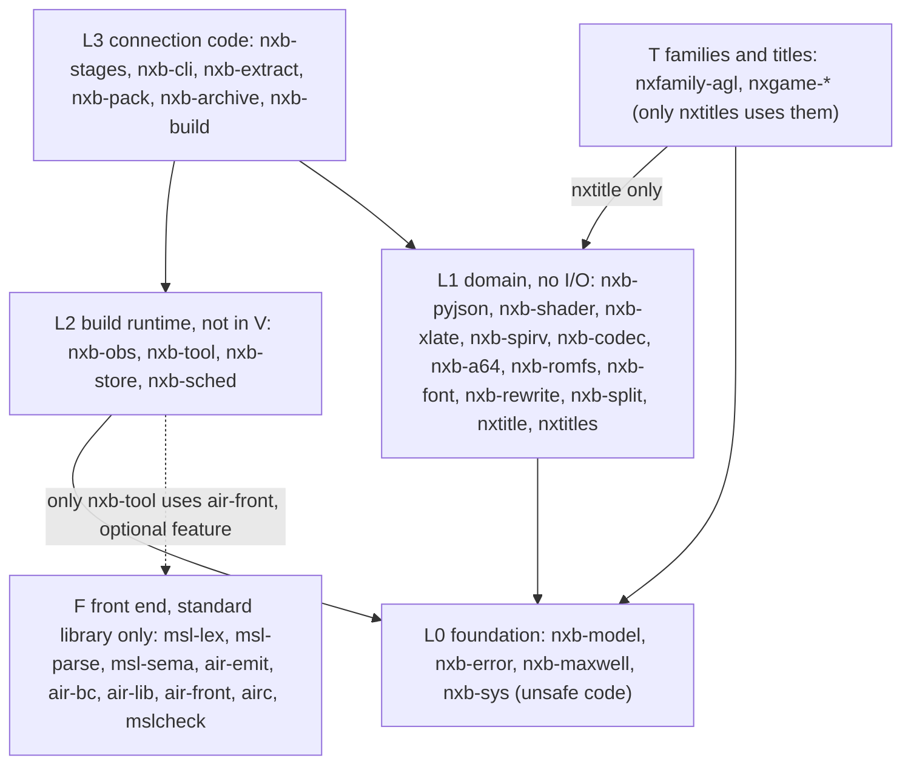
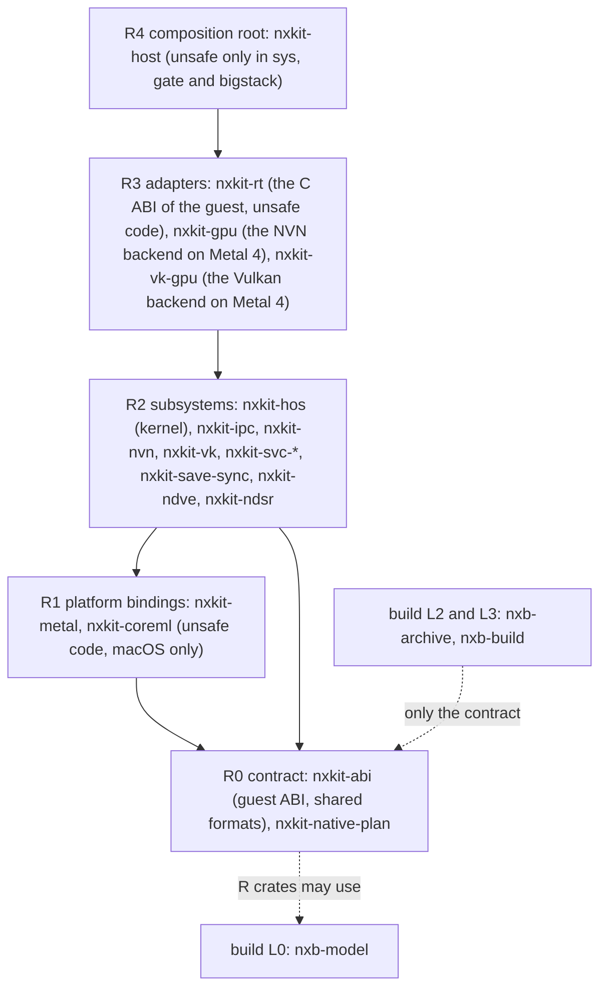
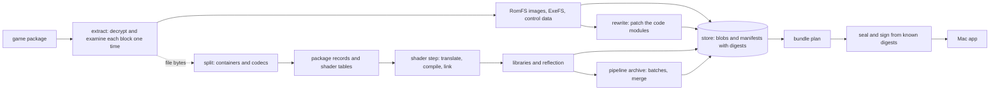

# Architecture overview

This document gives the structure of the workspace: the layers, the crates and the data flow between the stages.
For the decisions behind this structure, refer to [decisions.md](decisions.md).

## Workspace

- The repository is one Cargo workspace. The crates of the build are in `crates/`. The families and title modules are in `titles/` (refer to [titles.md](titles.md)). The developer tools are in `xtask/`.
- Each crate has the name `nxb-<concern>`. The front-end crates of layer F keep their names (`msl-*`, `air-*`, `airc`, `mslcheck`).
- `nxb-cli` makes the one program, `nxb`. Each stage is a command of `nxb`: `build`, `extract`, `split`, `shaders`, `sign`, `pso`, `archive` and `airc`. The other commands are `cache`, `prune`, `regressions`, `self-check` and `version`. The stage crates are libraries, and `nxb-cli` calls them. The stages have no other program and no dispatch by the program name. The front-end crates `airc` and `mslcheck` also build their own programs.
- The build crates use the standard library, plus `libz-sys` in `nxb-sys`. The runtime crates bind the Apple frameworks (Metal, GameController, Core Haptics, AppKit, Core Audio, VideoToolbox, Core ML) with the `objc2` family and `block2`, decode AV1 in software with `rav1d` and use `foldhash` for fast maps. `deps.toml` lists each external crate with its reason and its users.

## Layers

The workspace has two worlds. The build world (`nxb-*`, the front end, the titles) makes the app. The runtime world
(`nxkit-*`) runs the game in the app. Each world has its own layers. A crate can use only crates of a lower layer of
its own world, plus the sideways edges in the table below, plus the shared points named in the rules. The command
`cargo run -p xtask -- layers` makes sure that the crate graph obeys these rules. It reads the layer from
`[package.metadata.nxb]` in each `Cargo.toml` and the dependencies from `[dependencies]` and from every
`[target.'cfg(..)'.dependencies]` section (W25).

### The build world

### The runtime world

The rules:

1. L0 holds the identifiers, the digests, the error classes and the system calls.
2. L1 does no I/O. Its crates are pure functions over bytes and text that return `Result`. L1 can call `nxb-sys` only for pure calculations.
3. L2 runs tasks, keeps blobs, starts child processes and writes events. `nxb-tool` also wraps the Metal tools and the shader front ends.
4. L2 does not make output bytes of the shader step.
5. Only `nxb-sys`, `nxkit-rt`, `nxkit-metal`, `nxkit-coreml`, `nxkit-svc-video`, the module `sys` of `nxkit-hos`, of `nxkit-svc-fs`, of `nxkit-svc-offline`, of `nxkit-svc-system`, of `nxkit-svc-input`, of `nxkit-svc-audio` and of `nxkit-save-sync`, the modules `sys`, `gate` and `bigstack` of `nxkit-host`, and the module `guest` of `nxkit-abi` contain `unsafe` code. The reason in `nxkit-host` is calls into libc, dyld, Mach and AppKit in `sys`, and the assembly of the svc gate, the thread entry and the big-stack entry in `gate` and `bigstack`. All other crates forbid or deny `unsafe_code` in the lint settings of their `Cargo.toml`.
6. L3 connects the stages. One stage module has a maximum of 400 lines.
7. The development crates (`nxb-testkit`, `nxb-xlatedev`, `nxb-profile`, `xtask`) are dev-dependencies only.
8. Layer F uses no `nxb-*` crate. Only `nxb-tool` can use `air-front`, and only `nxb-cli` can use `airc`. Both are behind the cargo feature `air-front`.
9. Layer T holds the families and title modules. A `T` crate uses only `nxtitle` and L0. Only `nxtitles` uses a `T` crate.
10. A runtime crate (R0 to R4) uses only lower runtime layers, listed sideways edges and the build foundation L0 (`nxb-model` for the identifiers and the one SHA-256). A build crate uses only the runtime contract R0, and only from L2 or L3: the build writes what the host reads (the shard index of `nxkit-abi`).
11. R1 binds an Apple framework and knows nothing of the game. R2 holds one subsystem each, with its state in its own objects. R3 adapts the subsystems to a caller: `nxkit-rt` to the guest's C calls, `nxkit-gpu` to the `Backend` of the NVN front end. R4 is the one composition root: only `nxkit-host` creates the parts, reads the settings and wires the parts together (refer to "The runtime: composition and context").
12. Inside a crate the top-level modules form layers too. `xtask modules` makes sure that their cycles only shrink (W24, refer to "Module layers inside a crate").

### Sideways edges

| from | to | cause |
|---|---|---|
| nxb-error | nxb-model | the identifiers in the error types |
| nxb-model | nxb-sys | ARMv8 SHA-256 instructions. The digests do not change (W17). |
| nxb-shader | nxb-pyjson | the JSON files of the shader step |
| nxb-rewrite | nxb-a64, nxb-codec | the AArch64 decoder, the ZBIC segments of NSO files |
| nxb-split | nxb-codec | the ZBIC decoder |
| nxb-xlate | nxb-pyjson | the job file and the JSON of the reflection |
| nxb-cli, nxb-build | nxb-extract, nxb-pack, nxb-archive | the L3 stage crates (W19) |
| nxb-cli | nxb-build | the `nxb build` orchestrator (W19) |
| nxb-cli | nxb-stages | the shader step of `nxb shaders build` |
| nxb-build | nxb-stages | the shader step in the build graph (W19) |
| nxtitles | nxtitle | the registry builds the catalog of the title API |

The runtime world has no sideways edges. Its layers order every edge (W25).

## Crates

"V" means that the crate has `in_v = true` in `[package.metadata.nxb]`. The layer check makes sure that such a crate uses only crates with V. The chain version V itself is a hash of the host's shader chain files, plus the options string `debug=True reduced=True`. No Rust source goes into V.
"impl" means that the crate has a full implementation. The skeleton crates of earlier versions are removed (W30).

| crate | layer | V | state | function |
|---|---|---|---|---|
| nxb-model | L0 | yes | impl | identifiers (`ShaderKey`, `TitleId`, `Target`, `StageId`), `Digest`, own SHA-256, `ContentKey`, `HashingWriter` |
| nxb-error | L0 | yes | impl | error classes, reason strings, `BuildError`, `EnvError` with errno classes |
| nxb-sys | L0 | no | impl | process groups, memory size, core counts, locks, clonefile, zlib, AES, SHA instructions |
| nxb-maxwell | L0 | yes | impl | decoders for Maxwell and Ampere (sm_86) machine code of the game GPU |
| nxb-pyjson | L1 | yes | impl | a JSON writer that gives the same bytes as Python `json.dumps`. Measured: byte-identical on 16,269 JSON files of the reference title. |
| nxb-shader | L1 | yes | impl | the job writer, the chain version, guards, the header, the target conventions, the side library cut |
| nxb-xlate | L1 | yes | impl | the Rust translator: decode, control flow, SSA, passes, structured IR and MSL with a typed `Reflection` (`nxb_xlate::msl::translate`). Refer to [translator.md](translator.md) |
| nxb-spirv | L1 | no | impl | the shaders of a game on Vulkan (D21): one SPIR-V module to one MSL function with naga, the Metal slot of each descriptor (in (set, binding) order per class, as the old engine's `vk_shaders.py`), the dual-source variant, 1D images as one-row 2D images. Its own types, no host format: `nxb-build` names the functions and writes the rows of `nxkit_abi::vk_table` |
| nxb-a64 | L1 | no | impl | an AArch64 decoder and the encoders for the rewrite step. It follows Capstone 5 for the fields that the rewriter uses |
| nxb-rewrite | L1 | no | impl | the code rewrite: NSO and NRO load, rules as data, the five tables |
| nxb-codec | L1 | no | impl | the ZBIC decoder (`nxb_codec::zbic`). The other decoders of the build live in `nxb-split` and `nxb-rewrite` (W30). |
| nxb-romfs | L1 | no | impl | the index of a `DMROMFS1` image (read, move files) and a SARC member search. The RomFS tables and the layout plan are in `nxb-extract` |
| nxb-font | L1 | no | impl | the stand-ins for the console's shared fonts: unhinted cuts of a TrueType font for types 0 to 4 and the button icons of type 5, as NX2Apple's `make_shared_fonts.py` makes them. An own TrueType reader and writer, no I/O. `nxb-build` writes the fonts into each app |
| nxb-split | L1 | no | impl | containers, shader keys, package records and tables. It supports many container families (refer to [pipeline-stages.md](pipeline-stages.md)). Formats that are not ported stop with a named `Unsupported` error and exit code 4. |
| nxkit-hos | R2 | no | impl | the Horizon kernel: objects, handles, events, threads, `WaitSynchronization`, the lock, condition variable and address arbiters, the process memory and its svcs, IPC sessions and the SDK take-overs of the kernel side. Guest memory and the host's pages sit behind traits, so the crate has no `unsafe` code outside `sys`. Refer to [nxkit-hos.md](nxkit-hos.md). It uses `nxkit-abi` and the standard library |
| nxkit-ipc | R2 | no | impl | the IPC server of the nxkit host: HIPC and CMIF parsing, domains, the service manager `sm:`, per-command counters and the stop on an unknown command. No `unsafe` code, no global lock on the request path |
| nxkit-svc-fs | R2 | no | impl | the `fs` service: `fsp-srv` and its interfaces over IPC, the SDK-level `nn::fs` functions, the romfs through `mmap` and the save layout. `unsafe` only in `sys` (`mmap`, `pread`, `clonefile`, `renamex_np`) |
| nxkit-svc-offline | R2 | no | impl | the `offline` service: the answers for networking and peripherals the game cannot use here. `unsafe` only in `sys` |
| nxkit-svc-video | R2 | no | impl | the `video` service: `movie::Decoder` and `nn::codec` video decoders for VP9 on VideoToolbox and AV1 on VideoToolbox (M3 and newer) or rav1d (software), with `CVPixelBuffer` frames and a `CVMetalTextureCache` path. Source only, not yet compiled or run |
| nxkit-svc-input | R2 | no | impl | the `input` service: controllers, GameController and Core Haptics through `objc2`. `unsafe` only in `sys` |
| nxkit-svc-audio | R2 | no | impl | the audio service of the nxkit host: SDK take-overs, `audout:u`, `audren:u`, `IAudioDevice`, and a mixer in the AUHAL callback (R41, R42). It is not compiled or tested yet |
| nxkit-svc-pacing | R2 | no | impl | the `pacing` service: the `Pacer` for present intervals and the frame pace profile |
| nxkit-save-sync | R2 | no | impl | the cloud saves (R69): the save of user 1 and the device save packed into one file in a cloud folder, byte-compatible with `dm/host/save_sync.c` of the old engine, the decision at the first mount with the journal of a pull, the sender after commits and the report for a launcher. It works on folders and knows nothing of the fs service. `unsafe` only in `sys` (`renamex_np`, `clonefile`, the guest-name attribute, `localtime_r`, `sysctlbyname`) |
| nxkit-native-plan | R0 | no | impl | the native passes as data (`Plan`, `Step`, `GameResource`, `Binding`), shared by the networks that `nxkit-gpu` runs natively. No Metal code |
| nxkit-ndve | R2 | no | impl | the movie network of `nn::ndve` run natively: file reader, weight packing, the plan and Metal kernels, and the `ane` module that writes the Core ML model for the Neural Engine. Refer to [plans/ndve-native.md](plans/ndve-native.md) |
| nxkit-ndsr | R2 | no | impl | the agl upscaler NDSR run natively: network table and fingerprint of the packs `vr` and `vr_light`, pack reader, CPU reference, kernels and plan. Refer to [plans/ndsr-native.md](plans/ndsr-native.md) |
| nxkit-coreml | R1 | no | impl | Core ML on the Neural Engine over IOSurface tensors (`objc2-core-ml`). It knows nothing about the network. Refer to [plans/ndve-ane.md](plans/ndve-ane.md) |
| nxkit-abi | R0 | no | impl | the shared contract of the host: guest memory access (`guest`, `unsafe` only there), the export type, the IPC service trait and its request and response types, the registration of the kernel and the IPC server, the console platform, the shared formats that the build writes and the host reads (the shard index of the pipeline archive, `shards`, and the shader table of a Vulkan game, `vk_table`) and the settings snapshot (`env`) |
| nxkit-metal | R1 | no | impl | the Metal 4 binding of the host, macOS only: device, queue, compiler and residency, the guest memory as one no-copy `MTLBuffer`, pipelines and archives, command buffers, ICBs, the presenter and the display link, and the page traps of the private memory. All `unsafe` Metal calls are here |
| nxkit-rt | R3 | no | impl | the C ABI that the guest calls: `nxkit_init`, the export lookup (`nxkit_hle_find`), the kernel start and the svc entry, the NVN procs over `nxkit-nvn` the Vulkan exports over `nxkit-vk` (`vk`, only in the table of a Vulkan game: `entries_for`) and the SDK functions around NVN (`gfx`). `unsafe` code |
| nxkit-host | R4 | no | impl | the main program of the host (`nxkit-host`, plus a library): the guest memory reservation, the loader of `nxgame.dylib`, the svc and TLS gates, the big-stack entry, the game threads and the AppKit window. Its contract with the build stage is [nxkit-host.md](nxkit-host.md). It runs on macOS only. |
| nxkit-svc-system | R2 | no | impl | the system services as `Service` objects: `set`, `set:sys`, `apm`, `time:*`, `acc:*`, `appletOE`, `appletAE`, `pctl*`, `nifm:u`, `friend:u`, `prepo:u`, `lm`, `psm`, `ssl`, `bcat:u` and `aoc:u` (R37), and the SDK exports of the take-overs (R38a). The module `sys` holds the clock, time zone and guest call functions |
| nxb-obs | L2 | no | impl | NDJSON events, sinks and the code table (`code` and `severity`) |
| nxb-profile | dev | no | impl | the profile of a game as typed data, with a TOML reader and writer. The tests of the title modules use it to check their `profile.toml` (W31) |
| nxb-tool | L2 | no | impl | `Tool` trait, `Invocation`, environment allow list, watchdog, circuit breaker, `FrontEnd` trait |
| nxb-store | L2 | no | impl | content-addressed blobs, keyed entries with manifests, quarantine, cache export and import |
| nxb-sched | L2 | no | impl | work-stealing executor with token and memory budgets, single-flight |
| nxb-stages | L3 | no | impl | the shader step. It calls `nxb-xlate` in the process |
| nxb-cli | L3 | no | impl | the program `nxb` with all commands |
| nxb-extract | L3 | no | impl | extract and fused split for NSP, XCI, NSZ and NUP. The commands are `nxb extract` and `nxb split` |
| nxb-pack | L3 | no | impl | the ad-hoc signer and the staging of a file set into a bundle (`nxb sign`) |
| nxb-archive | L3 | no | impl | the pipeline archive: plan, batches, merge |
| nxb-build | L3 | no | impl | the orchestrator `nxb build`: it builds only games that have a title module, into an app with `nxkit-host`. For a game on Vulkan the shader stage makes `vk_shaders.metallib` and `vk_shaders.tsv` with `nxb-spirv` (`standalone::vk_shaders`), with no shader split and no pipeline archive |
| nxkit-nvn | R2 | no | impl | the NVN front end of the nxkit host: GPU addresses, texture layout and descriptors, recording in command memory and render pass inference. Pure Rust, no Metal. Refer to [nxkit-nvn.md](nxkit-nvn.md) |
| nxkit-vk | R2 | no | impl | the Vulkan front end of the nxkit host (R64): the device the game sees (Tegra X1, Vulkan 1.1), formats, handles and objects, descriptor sets, typed recorded commands and the `Backend` seam for `nxkit-vk-gpu`. Pure Rust, no Metal, no C ABI |
| nxkit-gpu | R3 | no | impl | the frame encoder of the nxkit host, macOS only: it turns a held `nxkit-nvn` frame into Metal 4 work with ICBs for reused recordings, bindless textures, barriers where data flows, tile memory and parallel encoding. No `unsafe` code. Refer to [nxkit-gpu.md](nxkit-gpu.md) |
| nxkit-vk-gpu | R3 | no | impl | the Vulkan backend of the nxkit host, macOS only: `nxkit_vk::Backend` on `nxkit-metal`. Device memory below `1 << 39` as no-copy buffers, textures, pipelines from `vk_shaders.metallib` and its `vk_table` rows, one command buffer per submit, and the swapchain images through the `Pacer` as a `TickSink`. No `unsafe` code |
| nxtitle | L1 | no | impl | the title API: `Family`, `Title`, the hooks, `Fact` and `Evidence`, the `Catalog` that composes them. Refer to [titles.md](titles.md) |
| nxtitles | L1 | no | impl | the registry: one cargo feature per family and title module |
| nxfamily-agl | T | no | impl | the family of Nintendo EPD games on sead, agl and gsys |
| nxgame-oot | T | no | impl | The Legend of Zelda: Ocarina of Time for Nintendo Switch 2 (`0400486024DEC000`) |
| nxb-testkit, nxb-xlatedev, xtask | dev | no | impl | seeded generators, the corpus tool of the Rust translator (`xlate-corpus`), the checks of the workspace (layers, sizes, module cycles, the settings source, the statics of the runtime) |
| msl-lex, msl-parse, msl-sema, air-emit, air-bc, air-lib, air-front, airc, mslcheck | F | no | impl | the own front end. Refer to [frontend.md](frontend.md). |

## Module layers inside a crate

The crate graph has a checker since W7. Inside a crate, the top-level modules had none, and on 0.10.3 there were 34
cycle groups with 159 modules (`xtask modules`, W24). The largest were 38 of the 54 modules of `nxkit-gpu` and 10 of
the 16 modules of `nxb-xlate`. A cycle group is one unit for a reader and for a change: nobody can understand or
test one of its modules without the others. The two large crates get explicit module layers. A module uses only
modules of its own layer or below. `xtask graph <crate>` shows the edges that are left.

### nxb-xlate (W28)

| layer | modules | what it holds |
|---|---|---|
| 0 base | `types`, `job`, `accessor`, `corpus` | the job model, the answers of the job, the shared value types (sampler types, the resource lists of a program) |
| 1 IR | `ir` | operands, operations and blocks in an arena, the aggregate types of the structured IR. No translation state |
| 2 state | `translation` | the state of one translation: header, definitions, host capabilities, shader properties, the resource manager, the attribute usage, the function patterns |
| 3 decode | `cfg`, `emit` | control flow from the machine code, and the instruction emitter (`emit::context` is the `EmitterContext`) |
| 4 passes | `helper`, `opt`, `xform` | the helper functions, the optimizer, the transforms (`xform` uses `opt`, never the other way) |
| 5 structure | `props`, `structured` | the structured program and the back end's view of the definitions |
| 6 front end | `driver`, `front` | the retry loop and the pipeline from the machine code to the structured program |
| 7 back end | `msl` | the MSL text, the libraries and the reflection, and the entry `msl::translate` |

`msl` sits on top because its entry translates a job from the start: it runs the front end and then writes the
libraries. Before W28, `translation` held both the state and the pipeline, so the IR and the passes depended on the
pipeline that calls them.

### nxkit-gpu (W29)

| layer | modules | what it holds |
|---|---|---|
| 0 support | `fastmap`, `ordinal`, `skip`, `lru`, `json`, `jobs`, `format_map`, `settings`, `guest`, `diag` | general helpers, the ordinals of a frame's commands, why a command is skipped, the format tables, the settings and the diagnostic switches (`diag`: categories, knobs, filters and the handle map of the `barr` check) |
| 1 frame data | `detail`, `stats`, `poolreg`, `pools` (with `pools::overlay`), `guestpools`, `translate` | what the front end hands over, the counters of a frame, the pool map, NVN state values in Metal terms |
| 2 resources | `snapshot`, `textures`, `upload`, `scaled`, `copyback`, `clear`, `programs`, `pipelines` (with `pipelines::coverage`), `pull`, `bindless`, `gmem`, `images`, `rename`, `private` | the Metal objects of the resource table |
| 3 planning | `drawctx`, `probe`, `geometry`, `draws`, `mesh`, `indirect`, `barriers`, `native` (with the NDSR and NDVE replacements), `queries`, `icbs` | what the planning of a draw reads (`drawctx::Shared`), one draw or dispatch in Metal terms, the native replacements, the GPU counters, the indirect command buffers, and the observer interface of the analyses (`probe`) |
| 4 encode | `encode` (with `EncodeCtx`), `passes`, `encthread`, `blit` | the Metal 4 command buffers of a frame |
| 5 analyses | `gatediag`, `health`, `meshvis`, `nanscan`, `lum`, `passprof`, `overlap` | the opt-in analyses. The encode path reaches them only through `probe` |
| 6 frame driver | `report`, `gpu`, `backend`, `walk` | the public entry: a held frame in, a shown frame and an `EncodeReport` out |

The core path (layers 1 to 4) knows the switches of `diag` and the interface of `probe`, and no analysis module.
`gpu::PROBES` installs `nanscan` and `lum` as hooks, `passprof` is a `probe::PassClock` and `meshvis` a
`probe::MeshCounts` in the GPU counters. Each analysis keeps its own `NXKIT_DIAG` switch, so a hook that is off
returns at once, as the direct calls did. Before W29, 38 of the 54 modules were one cycle group. Now the crate has
none. No module was split into a sub-crate: after the moves, no group of modules is cohesive and free of edges into
the rest, so a sub-crate would only add a public interface.

## The runtime: composition and context

`nxkit-host` is the composition root (rule 11). At start it reads `game.json`, the title's settings and the
`NXKIT_*` environment once, builds the kernel, the IPC server, the services, the NVN front end, the GPU backend and the
window, and connects them. No other runtime crate reads an `NXKIT_*` variable from the process or decides which part talks to which. (Variables of the system such as `HOME` and `TZ` are read where they are used.)

- **Context instead of globals.** A subsystem keeps its state in an object that it owns: the kernel in `Kernel`, a
  service in its `Service` objects, the GPU backend in `Gpu`. A caller gets the object passed in.
- **Injection instead of setters.** A part gets its dependencies as typed values when it is built, from the host:
  the loading screen of the start is `GpuSettings::prewarm_screen`, the command settings of NVN are
  `nxkit_rt::nvn::Settings::commands`, the analyses of the encoder are `nxkit-gpu`'s `probe` hooks. No new setter
  between crates.
- **The guest boundary.** The game calls the host through C functions with the Switch ABI (the svc gate, the SDK
  take-overs, the NVN procs). Such a call carries no Rust context, and neither does a signal handler, a Metal
  completion handler or the AUHAL callback. Their state is a process-wide value that the host installs once at start
  (a `OnceLock` of the crate's context). The anchor of each crate says why at its definition (`// Process-wide
  (W26): ...`), and `xtask statics` keeps the count of each runtime crate from growing (`xtask/statics.txt`, 393
  after the second round). W33 lists what may stay process-wide. Counters and once-guards of the diagnostics are atomics next to the code they count.
- **The frame path is objects of the run.** The host makes them in `run` and passes them to the parts that use them.
  `nxkit_nvn::screen::Screen` holds what the screen showed of the presents: the GPU backend writes it, the NVN present
  of `nxkit-rt` and the refresh plan read it. `refresh::Refresh` plans the display link for the screen: the pacing
  seam, the window delegate and the tick hook share it. The refresh plan owns the minimum stay of the presents
  (`nxkit_metal::TimedPresent`), which the frame ring of the present blit reads. The batch hooks of the `frame` and
  `gateseq` traces come from `nxkit-rt` through `GpuSettings` into the batch ring. The command buffer seam of `nxkit-rt`
  is a field of its `Gpu`, the overlap key of `game.json` is a field of the backend, the GPU and the walker, and the
  diagnostics of the present path belong to the `GpuBackend`. The video service gets its guest-write hook in its
  `Config`.
- **One source of settings.** `nxkit_abi::env::Env` is a snapshot of the `NXKIT_*` variables. `nxkit-host` takes it
  first thing in `run` (`Env::capture`) and parses it once into the typed settings of every runtime crate
  (`hostenv::RunSettings::from_env`). Each crate has a `settings.rs` with its keys, their defaults, their parsing and
  their docs in one place (`NvnSettings`, `RtSettings`, `GpuEnv`, `AudioSettings`, `VideoSettings`, `InputSettings`,
  `PacingSettings`, the host's own `HostEnv`). The host passes them to what it builds. Code with no context to carry
  them (a guest export, a switch deep in the encoder, an AppKit callback) reads the crate's settings through one
  accessor, `settings()`, over a `nxkit_abi::env::Slot`. `RunSettings::install` fills the slots before any part is
  built, and a slot that is filled twice, or that was read before it was filled, stops the run with an error. A unit
  test reads the defaults. No code outside the settings modules reads an `NXKIT_*` variable, and `xtask settings`
  checks this (W27). The one exception is the allocator hook of `nxkit-host` (`NXKIT_MEM_ALLOC`), which runs inside an
  allocation and uses libc `getenv`. [diagnostics.md](diagnostics.md) describes the variables of the diagnostics.

## Data flow of the stages

The arrows show data only. There are no barriers between the stages. The split starts on the first file that the
extract decrypts. The first archive batch starts when its libraries are in the store. Only the seal waits for all data.

## The host at run time: the parts that are not a straight translation

Most of the run time path is a direct image of the Switch: `nxkit-hos` threads, `nxkit-ipc` services, `nxkit-rt` NVN calls, `nxkit-nvn` frames, `nxkit-gpu` Metal 4 work (refer to [nxkit-gpu.md](nxkit-gpu.md)). Six parts do more than that. Each has a detailed plan, and this section gives the shape and the status. A number is marked **measured** (a run on the reference machine, an M2 Max unless said), **derived** or **assumed** (nobody checked it).

### Native replacements of tensor networks

Some games run a neural network as a chain of compute dispatches. `nxkit-gpu` (`native`) can replace such a chain by kernels of its own. The layer knows no network. A `Replacement` says how to find the chain (the program keys of the frame's dispatches), which bound weight buffers prove that it is the known network, and how to build a `Plan` (buffers, kernels, grids, bindings; the types are in `nxkit-native-plan`, with no Metal code). `Native::prepare` reads the weight bytes through the bindings and hashes them once per frame, looks the verdict up in a small LRU cache of plans (`NXKIT_NATIVE_CACHE`, 4), and the pass loop skips the game's dispatches and encodes the plan at the last one. Anything that does not match keeps the game's own dispatches, so the failure mode is the original picture and never a wrong one. `NXKIT_<NAME>=0` turns a network off, `NXKIT_<NAME>_COMPARE=1` runs both on a sampled frame.

- **NDVE** (`nxkit-ndve`): the movie upscaler of `nn::ndve`, a U-Net and a resampler on the 1080p picture. Plan: [ndve-native.md](plans/ndve-native.md), [ndve-impl.md](plans/ndve-impl.md). The GPU kernels take 5.8 ms for the full picture before, 4.9 ms after the fused layers (measured).
- **NDSR** (`nxkit-ndsr`): the in-game upscaler of the agl family. The packs `vr` and `vr_light` hold 15 network programs. Each has a CPU reference that matches the emulated SASS of the game bit for bit, and one Metal kernel. Each input and output size gets its own plan, because the dynamic resolution changes the size every few frames. The kernels are 1.7 to 2.2 times faster than the first version on the full picture (measured). Plan: [ndsr-native.md](plans/ndsr-native.md), [ndsr-impl.md](plans/ndsr-impl.md). The NDVE resampler is an NDSR network.

### The Neural Engine offload of NDVE

The Neural Engine runs the movie network faster than the GPU kernels leave room for. It is on by default; `NXKIT_NDVE_ANE=0` keeps NDVE on the GPU. Plan: [ndve-ane.md](plans/ndve-ane.md).

- `nxkit-coreml` loads a Core ML ML Program with `cpuAndNeuralEngine` and runs it over IOSurface tensors. It knows nothing about the network. `nxkit-metal` wraps an IOSurface as a texture. A model that is not all on the Neural Engine (`compute_plan`) is refused.
- The `ane` module of `nxkit-ndve` writes the `.mlpackage` from the weight blob in Rust (no Python at run time). The model leaves the quantise, the bilinear sample and the dither to a GPU epilogue (`ndve_ane_quant`, `ndve_ane_epilogue`). The package and the compiled model are cached by the weights and the macOS build.
- The picture is fed at decode time. `nxkit-svc-video` reports every decoded picture and the guest memory the game reads it into; a feeder converts it to the f16 input on the CPU (2 to 3 ms, measured in the study) and starts the prediction, three pictures ahead of the game. The first wiring, where the game's frame wrote the input and the result came one picture later, never had a result in time (1095 of 1101 pictures late, measured) and is gone.
- The game's dispatch finds its picture in three ways: the address of the read, the chain of the game's copies back to that address, and a luma fingerprint. A stream with 30 dispatches in a row that match nothing is given up. A dispatch without a ready result runs the Metal plan (`ndve.ane_fallback(reason)`).
- Status: the wiring has unit tests without Metal or Core ML. The study measured about 9 ms for the model on the Neural Engine; whether every picture is early enough in a game is read from the health counters and the `ndvetrace` report, not assumed.

### The movie path

AV1 movies decode on the CPU with rav1d on a worker thread of the stream (all cores up to 16, two frames in flight), or in hardware with VideoToolbox on M3 and newer. `Submit` only queues the packet. The worker is at most three pictures ahead of the game and never drains the decoder before the end of the stream, because a drain in the middle of a stream waited for ever with more than one frame in flight. An 8-bit 4:2:0 picture becomes NV12 by rows. Each picture has its own timestamp and an id for the Neural Engine feeder.

### The pipeline path, end to end

Details: [shader-step.md](shader-step.md), [plans/pipelines-at-build-time.md](plans/pipelines-at-build-time.md), [plans/pipeline-prewarm.md](plans/pipeline-prewarm.md).

1. **Build.** `nxb-xlate` translates the shader to MSL, the own front end or Apple's tools make the Metal library, and `nxb-archive` plans the pipeline archive: one unspecialized base for each shader pair. A vertex shader with stage inputs has a second library, `_bp`, that reads its streams itself (vertex pulling). The plan archives the `_bp` function, so its base has no vertex layout.
2. **Keys.** Batches are content keys. A translator change that touches only the shaders of one feature (now `hmma`) raises that feature's revision and not `TRANSLATOR_ID`; the crate version is in no key. A rebuild redoes only what changed.
3. **Shards.** Each batch is one `.mtl4archive` file under `pipelines/` with an index (`index.nxpi`). `MTL4Archive` read one merged file whole into memory (4.8 GB for one title, measured), so the host opens a shard when its first pipeline is asked for and keeps at most 32 open.
4. **Host.** For a draw `Pipelines` looks the pipeline up in the shards and the runtime archives. A miss takes the base of the pair and specializes it for the colour state with Metal 4 (`nxkit-metal` `pipeline/cache/specialize.rs`), on background threads (half the cores, 2 to 8, user-initiated QoS, the jobs of the latest frame first). The draw is left out until its pipeline is ready (`skip.pending`).
5. **Runtime cache.** Every pipeline the host makes is captured into `rt-*.mtl4archive` files with a list (`pipelines.seen`) beside the title. At the next start the host makes the pipelines of the list before the first frame (budget 20 s). The user does not rebuild after playing.
6. **Vertex pulling.** With `_bp` the draw binds a `dm_vlayout` block at buffer 16 and the pipeline has no vertex layout, so one base serves every layout. It is off unless `NXKIT_PULL=1`; otherwise `stage_in` stays.

Status: specialization, background builds, the runtime cache and the pull path are built. The archive served 21 % of the shader pairs of one title before the pull path (derived from the plan counts); the plan expects 96 % with it, **assumed until measured in a game**. Building every pipeline at build time (recorded states, a fetch-blend fallback) is a plan.

### Memory

- **The guest range** is one reservation of address space that is also one no-copy `MTLBuffer`. Its whole length counts in the Metal device total (and in the Metal HUD), touched or not. While the buffer is resident the GPU driver wires every page of it, touched or not, outside `phys_footprint`: about 12.4 GiB of wired RAM per run for the 12.5 GiB split of the first title (measured 2026-11-09, `docs/nxkit-host.md`, "What the GPU buffer costs"). The size of the heap and alias regions is therefore RAM; the host prints the game's peak use of them at the end of a run, and the title's `memory` profile sets them. Inside the buffer the kernel never puts other pages under the GPU (`nxkit_hos::pinned`): it zeroes in place and copies instead of remapping. `NXKIT_MEM_REPORT` counts the mapped, resident, dirty, compressed and wired pages per page.
- **Textures** have a Metal copy and the guest copy. The Metal copy of a texture that no frame used for 600 frames (`NXKIT_TEX_EVICT`) is dropped when the guest copy is current, and made again when the game uses it. A render target, a texture a frame wrote, one the CPU reads back and a memoryless, widened or scaled texture stay.
- **Pipeline archives** are heap while open: the shards, at most 32 (`NXKIT_SHARD_LRU`). The open shards close when the prewarm is over (`NXKIT_SHARD_TRIM=0` keeps them), because idle they are the first memory macOS compresses (1.1 to 1.6 GB measured with 34 to 38 archives open). Shader libraries stay loaded (`docs/nxkit-gpu.md`, "Memory").
- **Caches are bounded:** native plans (4), batch scratch (8 MiB per slot, doubling up to 64 MiB), pooled staging buffers for compressed uploads.
- `NXKIT_MEM_ALLOC=<MiB>` names who makes a large heap allocation.

### Pacing

Details: [pacing.md](pacing.md). The frame step is load-driven: it holds a frame for a number of vsyncs of 1/60 s from the cost of the frames. The profile (`pace_profile` in `game.json`) says how: `hold` (a late frame may stay longer, thermal cap on), `work` (a frame is judged by its work only) and `steady` (the step never leaves the cap's frame rate; a long frame shows late once and the game pays the time back). The variable step, which follows the measured time between shown frames, runs only under variable refresh (VRR) on an adaptive screen. A fixed screen keeps the load-driven step at 60 and a grid of ticks. VRR has not run on a screen yet (tests only).

Measured (`pacing.md`): the GPU lowers its clock when a paced frame leaves it idle (DVFS), so the GPU time in ms of the same work rises when the load per frame falls. Compare GPU times only at equal pacing, and do not read a rise in `NXKIT_PACE_DIAG` GPU ms after a speed-up as a loss.

## Store format and API stability

Each store key has a stage version and the content hash of the stage inputs. Only the translator key `nxb.xlate.v2` contains the chain version V (W21, [early-cutoff.md](early-cutoff.md)).

The store format 1 has these folders: `blobs/<2 hex>/<64 hex>`, `entries/<2 hex>/<64 hex>.manifest`, `quarantine/`, `tmp/`, `dirty/`.
A manifest is text with sorted names and a checksum line.

The API of the shared crates (`nxb-model`, `nxb-error`, `nxb-tool`, `nxb-store`, `nxb-sched`, `nxb-obs`) does not change in one primary version of the workspace. A change that breaks the API is a separate
commit with a note in `CHANGELOG.md`.
