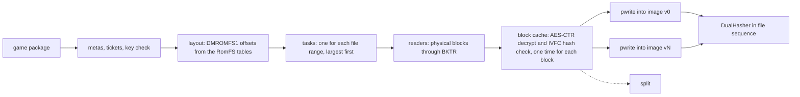

# Pipeline stages

This document gives the stages of `nxb build`: extract, split, rewrite, shader step, pipeline archive and the bundle, and the
signer. `nxb` builds only the app of a game that has a title module, with `nxkit-host` as its program. Each stage is a pure data change.
The acceptance rule is byte identity with stored expected output.

## Scope

These stages are in `nxb`:

- extract (NSP, XCI, NSZ, NUP to `extract/<ver>/`)
- split (shaders out of the game files)
- rewrite (patches of the code modules, with the rules of the title module)
- link and bundle (`nxgame.dylib`, `game.json`, the app with `nxkit-host`)
- pipeline archive
- the ad-hoc signer (`nxb sign`)

For the timings, refer to [benchmarks.md](benchmarks.md). Not in scope: a replacement of `metal-tt`, `metal-pack` or `clang`, an iOS app (nxkit has no iOS host yet), a game without a title module, a change of the host file formats
(`DMROMFS1`, package records, `romfs.id`, `prebuilt.tsv`), and network access.

## One hash for each byte

The stage that makes a byte calculates its digest while the byte is in memory. A subsequent stage does not read payload bytes again to hash them.

- A manifest holds for each file: relative path, mode, length, SHA-1, SHA-256 and a stat fingerprint (`dev`, `ino`, size, `mtime_ns`, `ctime_ns`).
- A consumer compares the stat fingerprint with one `fstatat` call. If the fingerprint does not agree, the consumer hashes the file and counts it. This is not an error.
- Only the `files` list of `CodeResources` uses SHA-1. `DualHasher` calculates SHA-1 and SHA-256 in one pass.

The store makes the work folder (`<id>_build/extract/<ver>/`, `shader/cache/b-<V>/`) with one directory clone on APFS, or with a copy on other file systems.

## Extract

- **Layout first.** The image format puts the file bytes in sorted entry sequence without padding, then the index.
  Thus the stage knows the offset of each file before it reads data. Parallel `pwrite` calls give the same bytes as a sequential writer.
- **One pass for all versions.** The base version and the update use mostly the same base blocks. The block cache decrypts
  and examines each block one time and gives it to all tasks that use it.
- **Damaged blocks.** A block that does not agree with the IVFC hash marks its files as damaged. Without `--allow-damaged`,
  the stage lists all damaged files and stops with exit code 3. With `--allow-damaged`, it writes the bytes and sets the damaged flag.
- **Special packages.** Each special case (sparse NCAs, XCI secure partitions, merged NSPs, NUP) gets a named test with a synthetic fixture.
- **Exit codes:** 1 error, 2 incorrect command, 3 damaged data, 4 not supported, 6 missing key.
  Exit code 4 means that the input is not supported. This is the same for `nxb split` and `nxb build`.

At this time, the stage supports NSP packages (NCA, IVFC, BKTR, RomFS image, ExeFS, NACP, zstd, LZ4).
It also reads game cards (XCI), compressed packages (NSZ and XCZ) and Switch 2 packages (`.nup`).
A `.nup` package needs no keys. Use `nxb extract --nup <game.nup>`.
The stage writes `extract/v<version>/` (ExeFS, RomFS image, control data and icon) and `aoc/<index>.img` for each DLC.
It checks each file against its size and its SHA-256, and it stops on a damaged or incomplete package.
Without `--version`, it takes the newest update. When the package has no base game, it uses the update as the whole game.
`--discard-images` makes the digests and does not write the images. `--no-images` writes only the code modules and the control data.

- **XCI.** The stage reads the secure partition of the game card.
- **NSZ and XCZ.** The stage decodes the NCZ block streams and the NCZ solid streams with the own zstd decoder.
  The decoder streams the data and has an output limit. The stage needs no external program.
- **Merged packages.** A package can hold more than one game. `--app <id>` gives the application id in hexadecimal.
  The stage then uses only the contents of that application.

Not ported at this time: the `--html` output of some titles. The base game of a sparse program stops with exit code 4 unless its update NSP is read in the same run.

### Tests on real data

- NSP: three titles.
- NUP: one real package (a standalone update). The RomFS image digest, the ExeFS and the icon are identical.
- NSZ: one real file. The digest of the decoded NCA is as expected.
  The NCZ block mode was not checked on real data.
- XCI and merged packages (`--app`): only synthetic fixtures. The output is as expected on these fixtures.
  No real sample was available.

## Split

- The split reads file bytes from the block cache of the extract. It examines a file when the extract decrypts the last block of the file.
  When the extract output is in the store, the split reads the image with `ParallelReader`. It reads a file only one time.
- Each container family is a module. `sniff` uses magic bytes, not file names. Nested containers recurse with a depth limit.
- The key of a shader is `sha256(control[:0x880] ‖ code)[:16]`.
- The output sequence is the contract. Rows record the first occurrence. The split sorts the results in the walk sequence:
  versions, sorted paths, `main`, NROs, captures. It does not use the completion sequence.

A title can say that its shaders lie only in the files under its `shader_groups` (`game.tsv` key `shader_scope groups`, from
`Standalone::shader_groups_only` of the title module). The split of `nxb build --nup` then reads every file under a group
as before, and every file outside the groups that is not compressed (a raw file costs one pass over bytes that are in memory
anyway). A compressed file outside the groups (zstd, a size-prefixed zstd or LZ4 frame, gzip, Yaz0) is not decoded and not
scanned. It is written to the RomFS as it is, raw. Without the key the split decodes and scans every file, so a title with
unknown groups keeps the full scan. The title sets the key only after a split of the whole game found every shader under the
groups. Ocarina of Time does so: all 42,851 file-sourced shader rows of the earlier split are under `/Shader/`, `/Effect/`, `/Lib/`,
`/Layout2Shader/` and `/Movie/` (measured on the tables of the earlier split). The result for the scanned files is the same as a full
scan. The stage output has one line of counters: files and bytes scanned and skipped, frames and bytes decoded, the CPU time
of the scans, and the wall time of the write and scan pass and of the archive jobs and merge. The unpack also deletes the
folder of an earlier run on all threads.

Since version 0.4.0, the split reads many more container families. A format that is not ported stops the split with a named
`Unsupported` error and exit code 4. The split never gives a silent difference.

| family | state |
|---|---|
| SARC, BNSH, BAHS, NSO, GLSLC outputs, NARC, sized frames, gzip files | ported. Checked on real or synthetic files |
| zstd dictionaries (standard format) | ported. Files of one real title are byte-identical to the output of `zstd -D` |
| archive families that the split reads by ranges (a large archive, zip, KPKA, CPK, dvdbnd, ARH, LINKDATA, Unreal packages and others) | ported. The split reads the archive by ranges from the image. A 17.6 GB archive is never in memory |
| NSO segments with ZBIC compression (flag bit 7) | ported. The decoder is `nxb-codec::zbic`. The split and the rewrite use it. The four modules of the Switch 2 package were read and each segment hash was checked. A synthetic NSO also passes |
| Unity bundles and serialized files (LZMA, LZ4, stored blocks, format 17 to 22, type trees) | ported. Compared on synthetic files only, because no real Unity title was available |
| Needle, Sumo, Phyre, MGFX, XNB, SLCT, Monolith, Snowdrop, SDF, MT Framework and some more | ported. Compared on synthetic files |
| formats that need Oodle or LZ5 (Oodle packs, Trinity packs, Frostbite superbundles, PKZ, GFPAK, Unreal 3 archives, Unreal pak blocks) | ported. The game's own decoder runs in the Mac host in its tool mode (`nxb-extract::oodle_host`). `nxb build` starts it when the profile's shader sources name Oodle packs or legacy Unreal paks, and only on a Mac with Apple silicon. `nxb extract` and `nxb split` alone have no host, so these formats still stop them with exit code 4. Compared on synthetic files with a fake decoder only |
| the CRA family | ported. `nxb-split::cra` unscrambles each file and checks its checksum. The file table is read from the NROs of the NRO folder, and a missing table stops the plan. Each NRO is also scanned like main. Checked on a synthetic NRO and archive made by `tools/gen_cra_fixture.py` |
| zip members (stored, Deflate, bzip2, lzma) | ported. The decoders are `nxb-split::bzip2` and `nxb-split::unity::lzma`. Compared with vectors from Python's `zipfile`, `bzip2` and `xz` |
| BND3 entry names in Shift JIS | ported. `nxb-split::sjis` decodes ASCII, half-width katakana and JIS X 0208 like Python's `shift-jis` codec with `replace`. A test compares all 65536 byte pairs with the codec. The table is made by `tools/gen_sjis_table.py` |
| Unreal shader code archives in paks, with an AES-256 index | ported in `nxb build` (`nxb-split::jobs::uejob`, `boot/uedec.rs`). The key comes from main. LZ4 shaders decode in nxb, Oodle shaders decode in one boot of the Mac host. The split reads `<version>/ue_shaders`. Checked with the AES test vectors of FIPS 197 and SP 800-38A and with synthetic archives. No real game was run |
| Unreal Engine 5.6 IoStore shader libraries | ported in `nxb build` (`nxb-split::jobs::uetoc` and `uelib`, `boot/uedec.rs`). The decode reads the `.utoc` tables and the `.ucas` partitions by ranges. Stored, zlib and LZ4 blocks decode in nxb. Oodle blocks and the Oodle shader groups decode with the game's own decoder in the Mac host. An encrypted container opens with the AES-256 key of the paks. The archive names come from the `Manifest_*.txt` files. Checked with synthetic containers and a fake decoder only. No real IoStore game was available |

Real data: the update image of one title with a 17.6 GB archive gave all 12 package files and all tables as expected (measured: 298 s).
The split reads approximately 35 container formats. Only the real image and the NSP titles have real-data results. For all other families, the evidence is synthetic.

## Rewrite

`nxb-rewrite` decodes each AArch64 instruction of each code module with the own decoder `nxb-a64`. It changes `x18`,
`tpidr*`, `svc`, `cntpct_el0`, misaligned `sp`, lock acquires, spin loops, cuts and observation gates. It writes
`.patched.bin` and six TSV tables. `nxb build` runs it for the modules that the title module lists, in the stage `rewrite`.

- **Input.** NSO modules. The loader reads LZ4 segments and ZBIC segments (a zstd variant, with an own decoder), and it checks the SHA-256 of each segment.
  The build ID of each module must be the one that the title module knows.
- **Decoder.** `nxb-a64` follows Capstone 5 for the mnemonic, the operand text, the registers and the write-back. A test compared 2.7 million distinct words of 9 modules with 0 differences.
  The decoder rejects some words that Capstone decodes (SVE, SME, MTE and most extensions after Armv8). The modules tested have none of these.
- **Layouts.** The rewriter has these layouts: near, far, and two patch areas. If the first size of the front area is too small, it runs again with the size that it needs.
- **Rules are data of the title module.** The patches of a game (cuts, frame step stubs and the build rows) are one TOML file in the title module (`rewrite_rules()`,
  for example `titles/games/0400486024DEC000/rules/0400486024DEC000.toml`). Each rule has a binding and, for a `build` rule, the original bytes. A `build` rule without its original bytes is an error.
  `nxb build` reads no other rule file: there is no folder of shared rules and no SDK patch table, and no environment variable names one.
  A case outside the rewriter's contract stops the stage with exit code 4.
  The licence notice of the engine patch data that the rules of the title modules come from is in `data/rewrite-rules/NOTICE` and in `THIRD_PARTY.md`.

The rewriter covers these changes: the acquire order of locks (`ldaxr`), the Trinity barrier, `changed.tsv`, the observation gates at each instruction that can move,
`BACK_MIN`, the recognizers of jump tables, the proof of tail calls and the finders `ue_cvar`, `ue_malloc`, `ue_region`, `fps_target` and `snowdrop_pools`.

The finder `ue_ring` runs on a main module (Unreal's dynamic buffers keep 4 copies instead of 3). `matchrule.rs` reads the word `0xe7ffdefe` as `brk #0`, and it accepts a replacement branch whose target stays inside the matched function.
They are in `crates/nxb-rewrite/src/ring.rs` and `matchrule.rs`.

The jump table rules are: a table's bound is the compare that a branch acts on, the walk for a table base passes a page-zero constant, and branches inside an exclusive window stay in its copy
(`jumps.rs`, `windows.rs` and `analyse.rs`).

The finders `ue_cvar`, `ue_malloc`, `ue_region`, `ue_ring`, `fps_target` and `snowdrop_pools` have no real positive sample. `ue_region` is tested on synthetic main modules (`crates/nxb-rewrite/tests/region.rs`, made by `tools/gen_synth_region.py`). `ue_ring` is tested the same way (`crates/nxb-rewrite/tests/ring.rs`, made by `tools/gen_synth_ring.py`).
The earlier comparisons with the output of the Python rewriter (`patch_nso.py`) were made before this engine path was removed. They are in the history of this file.

## The bundle

`nxb build` writes the app as `<name>.app.partial` and renames it when all stages are done. `Contents/MacOS/nxkit-host` is the program of the app.
The stage `bundle` adds `Info.plist`, signs `nxkit-host` ad hoc with the signer of `nxb-pack` and moves the app to its final path.
The save of an old app moves into the new app. Refer to [build-botw.md](build-botw.md) for the stages and [nxkit-host.md](nxkit-host.md) for the layout of the bundle.

## Code signature

### Ad-hoc signer

The ad-hoc signer is in `nxb-pack`. It gives the same bytes as `codesign --force --sign -` on the same input
(measured on macOS 27.2). For an input that it does not cover, it returns `Error::Unsupported` (exit code 3), and the caller runs `codesign`.

The sequence:

1. Sign the nested code first and record its cdhash.
2. Write `CodeResources` from the known digests: `files` with SHA-1, `files2` with SHA-256 (`hash2`), and nested code as `cdhash` and `requirement`.
3. Sign the primary executable: CodeDirectory version `0x20400`, SHA-256, special slots for `Info.plist` (1), requirements (2), resource seal (3) and entitlements (5 and 7).

The signer supports deep bundles, versioned frameworks and shallow bundles. It uses a 16 KiB page size for arm64
and 4 KiB for x86_64, tvOS and iOS before 16.0 (measured against `codesign`). For a real identity, the stage uses `codesign`.

The tests in `tests/oracle.rs` compare the output with `codesign` for many Mach-O and bundle types. All outputs pass `codesign --verify --deep --strict`.

## `nxb build`: inputs, options and exit codes

`nxb build` is the one command for the full build. The first argument is a folder of packages or a `.nup` file.
`nxb help build` shows the usage. Only a game that has a title module is built, and the result is an app with `nxkit-host` as its program.
A game without a title module stops with exit code 4. `--platform` takes `mac` or `mac-app` (the same app, `mac` is the default).
`--platform ios` is not supported: nxkit has no iOS host yet.

| input | how to give it | test condition |
|---|---|---|
| NSP | in the folder | real data (Breath of the Wild) |
| NSZ, XCI, XCZ | in the folder | the readers are the readers of `nxb extract`. One real NSZ file was checked there. XCI and XCZ were checked on synthetic fixtures only. **Synthetic or untested** through `nxb build` |
| merged package | in the folder, with `--app` or `--title-id` | **synthetic** |
| NUP | `--nup FILE`, or the only `.nup` in the folder | real data (Ocarina of Time) |
| DLC | `--aoc PACKAGE` (more than one time), or DLC packages in the folder | the DLC of Breath of the Wild is found by the dry run. The split does not read the shader content of DLC |

| option | function |
|---|---|
| `-k`, `--keys` | the keys file, needed for packages. A NUP needs none |
| `-o`, `--app-name`, `--bundle-id`, `--work-dir` | where the app and the work folder go, and the names |
| `--dry-run` | prints the plan (inputs, paths, stages) and writes nothing |
| `--allow-damaged` | files that fail the hash check are written as read and the build goes on |
| `--gpu ARCH\|none` | the GPU architecture of the pipeline archive. `none` skips the archive (and with it the recorded states below). Without the option, a game with `shader_pairs.tsv` uses the architecture of this Mac |
| `--pipeline-list FILE` | a list of the pipelines that the host recorded while the title played (`pipelines.seen` or `seen-<scheme>.list`). Without the option the build takes the lists of the app that it replaces (see "Recorded states") |
| `--threads`, `--load-limit` | the workers, and the share of CPU and memory that the archive may use |
| `--own-front on\|off\|VERDICTS` | the own front end for the shader libraries |
| `--shader-manifest FILE`, `--partial` | refer to the section on manifest-first builds |
| `--resource-patch OPTION=VALUE\|stock` | a resource patch that the title module declares |
| `--progress json\|bar\|lines` | the event stream, the live line or plain lines |

The options of the former engine path are gone: `--engine` and `NXB_ENGINE`, `--shaders`, `--companion-app`, `--dump`, `--program`, `--package`, `--language`, `--env-file`,
`--motion`, `--show-fps`, `--romfs`, `--seen-shaders`, `--mac-sign`, `--allow-other-metal`, `--allow-shader-regressions`, `--provisional`, `--survey-only`,
`--no-heap-check`, `--profile-out`, `--also-ios` and the iOS options (`--team-id`, `--framework`, `--shell-framework`, `--prepare-xcode`, `--xcode-workspace`).
Each one is now an unrecognized argument (exit code 2).

The pipeline archive is an optimization. If it gives an error, the build writes a `nxb: warning:` line and packs the app without an archive. The exit code is 0.

With `--progress json`, standard output has NDJSON events only. All other text goes to standard error.

With `--progress bar`, one live line at the bottom of the terminal shows the stage, the step, a bar with the count (files, bytes, shaders, modules or batches), the time left and the time spent. A count whose total is not known shows without a bar. The default `--progress auto` and `--progress lines` print plain lines and no escape codes, also on a terminal.

| exit code | meaning |
|---|---|
| 0 | done |
| 1 | error |
| 2 | incorrect arguments |
| 3 | damaged data |
| 4 | not supported (also a game without a title module) |
| 6 | a key is missing |
| 130 | interrupted by SIGINT or SIGTERM |

## Pipeline archive

The archive stage compiles one Metal 4 render pipeline base for each shader pair into native GPU code with Apple's `metal-tt`.

- `nxb pso` copies the plan, the script and the stamp byte for byte.
- The batches are cut by content. The bases are grouped by their vertex function. The groups are sorted by hash and cut into hash ranges.
  A new or removed base changes only the batch of its range. On a rebuild, the other batches come from the store.
- Each batch is a task that holds CPU and memory. The memory of a batch is 1.9 GiB for each 1,000 bases plus 512 MiB. It waits for the libraries that its bases use.
- Each batch runs `applegpu-nt -j 1` and then `air-pack`. The stage runs one batch for each core. A batch has up to 2,000 bases.
- When these tools are not found, each batch runs `metal-tt`. Then a batch has up to 1,000 bases and takes 2.2 GiB for each 1,000 bases. One batch runs for each two cores.
- The archive also holds a compute pipeline for each compute shader of the profile (`30fb2136` upstream).
  The `C` rows of `pso_manifest.tsv` come first. The compute rows of `shader_map.tsv` follow. Each library is listed once.
  A shader is left out when its reflection is missing or has another chain or stage, when its library is unreadable, when it has no entry, or when the entry has function constants.
  The script holds the pipelines as `compute_pipeline_descriptors`. Each one names its function and nothing else, as the host looks it up.
  The compute pipelines are compiled apart from the render bases, in groups of 16. A change on one side leaves the other side's batches in the store.
  `archive.tsv` has a `compute` line with their number. `nxb pso` takes `--shader-map` and `--manifest` (repeatable), and `--no-compute` builds the bases alone.
  `nxb build` reads the two tables of the profile.
- The progress of the batches (`batches done of total`, printed every 30 s in the lines mode) has a total from the start. The streamed archive counts one batch for each group of pairs when it starts, and corrects that when the group is planned, as a group is cut further or holds no pipeline. The total is then right when the last group has been planned.
- The merge puts the pieces in hash order (`metal-pack`).
- Measured on the reference title, cold: 207 s, and 958 to 1,076 CPU seconds.
  The loader probe found all 18,300 bases. The machine load was 7 to 33.
- Measured: `bases.mtl4-json` and `prebuilt.tsv` are byte-identical (18,301 pairs). The `metal-tt` output is not deterministic. Thus the tests compare archives by content.

### Recorded states

A plain base has no vertex layout, one sample, no alpha to coverage and no ICB support. The host specializes it to the colour state of a draw, which costs little. The host draws with stage inputs and the `_b` library unless `NXKIT_PULL=1`, so without pulling every draw of a vertex shader with inputs has a vertex layout, and the plain `_bp` bases serve nothing. A pipeline whose other state differs (a vertex layout, several samples, alpha to coverage, ICB support) has no base, and the host compiled it from the functions while the title played: seconds each, with the draw skipped until it was done. The host records every pipeline it makes (`pipelines.seen`, see [shader-step.md](shader-step.md#the-runtime-pipeline-cache)), so the build can compile them ahead.

- The build reads the lists, merged without repeats. It takes `--pipeline-list FILE` if given. Else it takes, from the app at the output path (the build replaces that app): `Contents/Resources/nxkit/pipecache/seen-*.list` and `pipecache/id-*/pipelines.seen`. It looks in `~/Library/Caches/nxkit/<title id>/pipecache/` (where the host keeps the cache when the app cannot be written) and in `$NXKIT_PIPELINE_CACHE_DIR/pipecache/` in the same way. A dry run prints the files it found, and a build prints one `pipeline list:` line for each.
- Each `R` line whose state is not the plain one (`nxb-archive::seen`) gives one more base in the script, after the plain bases: the pair, the vertex descriptor, the primitive class, the sample count, alpha to coverage and ICB support of the state, and eight colour attachments that are all `Unspecialized`. The colour state is not needed: the host specializes it. A state with other colours is the same base. A pipeline that the point size fallback made (`fallback` is 1) also gets the base without a primitive class.
- A base is added only when the plan accepts its pair by the rules of a plain base (same chain, no mesh stage, no function constants, no layer output, no primitive ID, the functions are in the libraries). The pair is planned as the host draws it with stage inputs: the `_b` library and the `entry` of the reflection, also for a vertex shader with a `pull` field (found with the real Ocarina of Time list: before this rule none of the extras matched, 1426 of 1429 states now do). A line that does not parse, or that names a vertex format the script has no name for (`FloatRg11B10`), is left out. Mesh and compute lines are not used: the archive has compute pipelines from the profile already, and the host builds mesh pipelines itself.
- The bases go into the batches like the plain ones (grouped by vertex function, so a state is in the shard of its pair unless a batch of a very large group is cut between them). The streamed archive gives each state to the group of its pair. `nxb pso` takes `--pipeline-list` (repeatable) and has the states in `bases.mtl4-json`.
- The host (`nxkit-metal`, `cache::specialize`) asks the archive for the unspecialized pipeline of such a state first, with the primitive class of the draw and then without one, and specializes it to the colours. When the archive has none, it compiles the base as before.
- Checked with Ocarina of Time: `nxb pso` on 11 pairs and 14 recorded states, then the host's prewarm over the same list from that archive: 14 of 14 made by specialization, 0 compiled. `NXKIT_DIAG=stats` or `pipe` says why a prewarm compile missed (`state base not archived ...`), and the ignored test `lookup_of_a_real_app` in `nxkit-gpu` (`pipelines/prewarm.rs`) runs the lookup against an app's shards or one archive file.
- The build keeps the lists in the new app: a list under the old app's `pipecache` keeps its place, any other goes to `pipecache/id-carried-<n>/pipelines.seen`.

### Where the state of an archive pipeline comes from

The plan (`plan::plan`) and the script (`plan::script_text_with`) give every base the same state: eight colour attachments with every field `Unspecialized`, and nothing else (no vertex descriptor, no topology class, one sample, no alpha to coverage). Nothing in the profile sets it. A pair is left out when its vertex shader has stage inputs and is not a pull shader (`left[2]`), when the fragment shader uses the primitive ID, when the vertex shader writes the layer, when the library has function constants (these go to `rest`), and when it is a mesh shader. `NXKIT_DIAG=stats` of the host says at run time which of these states the archive misses (see [diagnostics.md](diagnostics.md#archive-coverage)).

The profile's data that holds real states:

- `pso_manifest.tsv` has `S` rows (shaders), `C` rows (compute shaders, used by the archive) and `R` rows. An `R` row is the hex of a `pso_skey` (`nvn_pso_skey.h` of NX2Apple): the two shader keys, the colour formats of eight slots, the depth and stencil formats, the sample count, the blend enable and write masks, the alpha to coverage flag, eight blend states, 16 vertex attributes and 16 vertex streams, and the fragment variant flags. The formats and blend factors are NVN values. The Ocarina profile has 1,112 such rows. The archive does not read them.
- `shader_seen.tsv` lists shader keys seen in play (7,279 lines for Ocarina). It is a list of shaders and not of pipelines. Only `--seen-shaders` reads it.
- `shader_facts.tsv` has the answers for translation queries (thread group, shared memory), not pipeline state.

To use the `R` rows the build has to translate their NVN formats, blend states and vertex layouts into Metal descriptor fields. The table for that is in `nxkit-gpu` (`translate.rs`, `format_map.rs`), a macOS-only L2 crate that `nxb-archive` cannot depend on. It needs a shared table first. Not done.

### Cost of the compile

Measured on this Mac (M2 Max, `applegpu-nt -arch applegpu_g14s -j 1`, toolchain 32023.922, other builds running, CPU seconds from `time -l`) with batch scripts of the Ocarina build:

| test | result |
|---|---|
| 24 pipelines, `Unspecialized` attachments against one concrete attachment (`RGBA8Unorm`, no blend) | 21.7 s against 20.0 s. The state is not a lever |
| the same 24 with `-disable-optimizations` | 20.9 s. It changes nothing in the time |
| one pipeline with a large vertex function, then 4, then 24 pipelines that share that vertex function | 17.8 s, 26.6 s, 168 s. A vertex function is compiled once for a run (the first pipeline pays for it, 2.9 s for each next one). The cost of a function varies from 0.1 s to more than 15 s |
| peak memory of a run | 0.5 GB at `-j 1` for these scripts |

The pairs of Ocarina (`shader_pairs.tsv` and `pso_pairs.tsv`, 34,649 different pairs): 16,341 vertex keys and 22,329 fragment keys. Cut by the hash of the vertex key into 128 ranges, a vertex key is always in one batch, so the vertex functions are compiled once (16,341 times). A fragment key is compiled in each batch that holds it, 33,994 times against 22,329 keys, but 22,329 of the pairs have a fragment key of their own, so a change of the cut would save at most a few percent. The libraries of the pairs have 49,620 files with 47,441 different contents. Content-equal pairs are 224 of 34,649 (0.65 %): not worth a second dedupe pass. The remaining cost is the compile of each distinct function and pipeline, about 0.9 s of CPU for each pipeline on this sample. A cold build is bounded by the CPU time (34,650 pipelines at about 0.9 s are 31,000 CPU seconds, 55 minutes at ten busy cores). Tuning batch size or the number of runs does not reduce it. Fewer runs only help when the machine swaps, which `Headroom` already watches.

For the study of the archive back end, refer to [research/backend-survey.md](research/backend-survey.md).

## Events and codes

`nxb build` writes NDJSON events: `stage`, `stage_end`, `step`, `progress` and `say`. Since 0.4.0, each event has the fields `code` and `severity`.
The new fields come after the old fields, and `t` stays the last field. No old field changed.

- A code has the form `NXB` and four digits. A code never changes its meaning after a release. The table is in `nxb-obs/src/codes.rs`.
- `1xxx` is for the events of the build and `2xxx` is for the events of the library.
  `3xxx` is reserved for the cache and `4xxx` is reserved for the manifest and the partial state.
- The severity is `debug`, `info`, `warn` or `error`. A `say` text that starts with `[RED]` or `nxb: error:` has the severity `error`. A text that starts with `[YELLOW]` or `<program>: warning:` (`nxb: warning:`, `nxkit-rt: warning:`) has the severity `warn`.
  A failed `stage_end` has the severity `error`.
- A test makes sure of three facts. Each event has a code from the table. The code and the event name agree. The field `t` is the last field.

The shader step adds fields to the `say` event "shaders done": `xlate_hits` (translations from the store) and `xlate_refused` (an object of reasons and keys).

## Cache export

`nxb cache` moves the cache of one title between stores.

- `nxb cache export <store> <out> [--device-family F] [--translator T] [--emitter E] [--variant V]` writes one file.
- `nxb cache import <store> <file> [--cap-mb N]` reads a file. It hashes each blob again and checks the checksum at the end of the file.
  It checks that the key of each entry is the key that the entry names. A damaged file adds no entry.
- `nxb cache prune <store> --cap-mb N` removes the entries that were not used for the longest time, and then the blobs that no entry uses.
- `nxb cache list <store> [filters]` lists the entries.

A cache key has the shader key, the translator id, the emitter id, the device family and the variant. The export file has the format `nxb-cache-export 1`, and the same entries give the same bytes.
Tests: a round trip, 60 random single-byte changes and 4 cuts (all refused with no entry added), and the limit of the size. **The shader step does not write these entries yet.**
Thus the command works on a store that other tools filled. A cache that the shader step made is not yet in this form.

## Manifest-first order and partial builds

`nxb build --shader-manifest <file>` takes a list of shader keys (one for each line, `#` starts a comment). The shader step translates these shaders first, in the order of the list.
The other shaders keep their order. `--partial` needs the manifest. It builds only the listed shaders and writes `_b_partial.json` (`{"partial":true,"built":N,"total":M}`) into the output folder.
The summaries of the shader step and the archive then have the line `partial prebuilt state: N of M shaders`. A full build later removes the marker.
Without the options, nothing changes. The unit tests check the order and the marker. No full build with a manifest was timed.

## The profile of a game

The crate `nxb-profile` (layer L2) holds the profile of a game as typed data: computed values, declared values with a proof for each override, and rules (engine, frame limit, cuts with a reason).
It has a reader and a writer for a subset of TOML (the workspace has no external crates). It finds problems such as an override without a proof or a cut without a reason.
The title modules use it for their `profile.toml`. `nxb build` writes a small `game.tsv` into `<work>/profile` from the title module for the shader split; nobody edits that file.

## Byte identity for each stage

| stage | byte-identical to the stored expected output | not compared |
|---|---|---|
| extract | `RomFS.img` (header, data, index, names, damaged flags), ExeFS, `control.nacp`, `icon.jpg`, `html*/`, `romfs.id`, exit codes | log text, times |
| rewrite | all six outputs of each module | |
| split | package records, `shader_map.tsv`, answer table, `shader_pairs.tsv`, `pso_pairs.tsv` | progress lines |
| signer | `CodeResources`, the signed Mach-O files (against `codesign`) | |
| pipeline archive | `prebuilt.tsv`, `rest_pairs.tsv`, `archive.tsv` | `metal-tt` output bytes |
| events | the NDJSON stream | timestamps, time estimates |

These stages are not part of the chain version V. An intentional output change is a separate pull request with its own format version.
