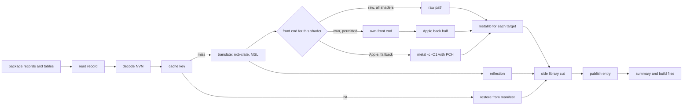

# Shader step

The shader step changes the GPU machine code of a game into Metal libraries. The command is `nxb shaders`. The code is in
`nxb-shader` (L1), `nxb-xlate` (L1), the runtime crates (L2) and `nxb-stages` (L3).

## Rules

1. **Port rule.** A port gives the same files for the same inputs, and the output does not depend on the number of tasks.
   This applies to orchestration, guards and the store. The translator is the exception (refer to the section on the translator).
2. The tests compare the last output files (`.metallib`, `.json`, `.metal`, tables), not `.air` files.
   The `.air` bytes can differ when the libraries are byte-identical (measured on 300 of 300 libraries).
3. **Front-end rule.** The own front end changes bytes by design. It ships with a fallback to the Apple front end for each shader
   (refer to [frontend.md](frontend.md)). The own-identical tier has proof for each shader. **The raw tier has no proof for each shader since 0.4.0.**
   It is the one exception to the rule: it is on for all shaders, and only a part of the corpus has a GPU test (refer to the section on the raw tier).
4. A port and a front-end change are not in the same pull request.

## Interfaces

| interface | contract |
|---|---|
| input from the split | package files `<stage>_<group>.bin` (`BTCDBTCD` records) and the tables `shader_map.tsv`, `shader_facts.tsv`, `shader_pairs.tsv`, `pso_pairs.tsv` |
| translator | `nxb_xlate::msl::translate(&job, &code, &ctx)`, called in the process for each key. The job is the job JSON of the translator |
| output of the translator | the libraries of the key (`<key><suffix>.metal`), the reflection of the libraries that have one, the inputs of a pixel shader and the side library entries |
| output to the pack stage | `b-<V>/` folders, `inputs.tsv`, `_b_build.json`, `_b_cas.txt`, `c1_full.tsv`, `cb_extent.tsv`, the reuse keys |
| output to the archive stage | `pso_pairs.tsv` and the reflection fields `entry`, `entry_z`, `pull`, `vertex_inputs`, `raster.primitive_id`, `bindings` |
| progress | NDJSON events |

## Task graph



The step does not run the cache checks in series, then all translations, then two thread-pool passes.
The shader step streams: each shader goes to the next task when its inputs are ready. The only real dependencies are the
vertex shaders that wait for their pixel shaders (the `partners` of the translator context) and the summary at the end.

## Translator

The step translates each key with one Rust translator, `nxb_xlate::msl::translate` (refer to [translator.md](translator.md)). It runs in the process, behind `catch_unwind`.
It needs no .NET runtime and no external translator program. The output is MSL. The translator fills the `Reflection` of each library.

The step does this for each key:

1. It reads the code and the job. It calls the translator with the context: the chain version V, the source (`<package>#<index>`), the paired shader (`pc_paired`), the answer-table flag, the dual-source and fetch-outputs-only flags (from `dual_want.tsv` and `bf_want.tsv` of the profile) and the partners.
2. A vertex shader or a mesh shader waits for its pixel shaders. It gets their `StageInputs` (the user varyings) as the partners, in the order of the pairs table. A pixel shader that failed gives no inputs.
3. For each `Library`, it writes `<key><suffix>.metal`, compiles it and writes `<key><suffix>.metallib`. A library with a `Reflection` also gets `<key><suffix>.json`. The step writes `_b.json` last.
4. When the translation has a `Side`, the step compiles `_b` and cuts it into `_b` and `_bx` at the metallib level. The cut keeps the alpha test entries and the logic op entries in `_bx`.
5. The variant libraries `_bf`, `_bp` and `_bv` are optional. If one does not compile, the step skips it and removes its field from `_b.json`.
6. A geometry shader (`gs`) needs no `geometry_topology` in its job. The translator makes the kernels for all input topologies, so the step writes `_b`, `_bg0` to `_bg4` and `_bgv`, each with its own `.json`. A passthrough geometry shader also gives `_bl0`, `_bl1` and `_bl3`.
7. The job of an NVN2 task or mesh shader (`ts`, `ms`) has stage `cs`, the code without its 0x80 byte SPH, `mesh_stage`, `stage_memory`, `local` and `shared`. `mesh_stage` of a mesh shader has `verts` (control +0x5f, 3 when 0), `max_v`, `max_p` and the lists `vertex` and `primitive`. The point size is the first entry of `vertex`, written as `["psiz", 0]`. It has no answer-table members. A job whose shader has shared memory of its own, or whose stage memory is past Metal's limit, carries `refused` in `mesh_stage`.

The reasons of a failure are fixed reason strings (`translation failed`, `metal failed` and the reasons that the translator names).
A panic and a job that the step cannot read are `translation failed`. The step counts each reason. The run report and the `shaders done` event have the counters `xlate_hits` (translations from the store) and `xlate_refused` (an object of reasons and counts).
A key that the translator does not do is a `ShaderError` of that key. The build continues.

The translation store key has the translator identity, the job, the code, V, the source, the paired shader, the answer-table flag, the dual-source and fetch-outputs-only flags and the partner varyings.
The translator identity is a hash of the label `nxb-xlate msl`, V, `nxb_xlate::msl::TRANSLATOR_ID` (now `msl-2.19`) and `NXB_TEST_XLATE_SALT`.
No Rust source goes into V. A change of the translator translates again only when someone increases `TRANSLATOR_ID` by hand. Without the increase, the store gives the old MSL. A failure is not stored.
A feature revision (`nxb_xlate::msl::revision`) translates again only the shaders whose code uses that feature.

The output is not byte-identical to the output of the former C# translator and `spirv-cross`. No game ran with it yet (D20). Unit tests and Metal compile tests on built samples cover it.

## Versions and keys

| identity | function | made from |
|---|---|---|
| V (chain version) | names the folder `b-<V>/` that the host loads. Each `_b.json` file has the same value | the host's shader chain files, and the options string `debug=True reduced=True` |
| TOOL_FP | the external tools that made a result | translator identity, `metal` identity, SDK version, deployment target, PCH convention, front-end id |
| BIN_ID | the `nxb` binary that ran | SHA-256 of the binary, rustc version, `Cargo.lock` digest, commit, flags |

The rules for these identities:

1. V comes from the host's shader chain files, not from the binary. No Rust source goes into V.
2. `TRANSLATOR_ID` in `nxb-xlate` is a string. Increase it by hand for each change of the translator output. For a change that alters only the shaders of one feature (`HMMA`), increase that feature's revision in `nxb_xlate::msl::revision` instead.
   The crate version is in no key. V of a build without the engine and the front-end id `air-front@0.10.0+f<FORMAT>` keep a fixed base, so a release keeps the store.
3. The runtime crates are not in V, and TOOL_FP does not contain BIN_ID. A new binary from the same sources keeps V and all cache keys.
4. The design compares BIN_ID with a lock file at start, and a mismatch is a `[RED]` build error. The code does not have this check at this time. The command `nxb self-check` only finds the external tools and shows their versions.
5. The reuse key of the build contains BIN_ID. After a runtime fix, the shader step runs one more time, with cache hits only.
6. The own front end does not change V. The compiler identity `dmsh_mtlcache 2` (the `chain_compiler` field of the reflection) stays.
   When the own front end is on, the library key `nxb.metallib.v2` gets a `frontend` field. Apple libraries and own libraries thus do not share a store entry.
7. Since 0.5.1, the value of V in each `_b.json` file is the computed V. In 0.5.0, the vertex shader files had the constant `0ad559cdbb28`.
   The folder name had the computed V. The two values were not equal. In a full Wonder run with the 0.5.0 code, the pipeline archive found no base library. The build packed the app without an archive.
   The calculation of V reads the shader chain files of the host.

## Execution model

- **CPU.** The default number of tokens is round(P + 0.4 x E). P is the number of performance cores and E the number of efficiency cores.
  `--jobs` of `nxb shaders build` and `--threads` of `nxb build` set another number. A thread task or a child process holds one token. The target is a use
  of 90 % or more of the PCE until the last 5 % of the tasks.
- **Priorities.** The step translates in key order. First come the keys that wait for no other shader, then the paired vertex shaders.
  A consumer order (the pair groups of the pipeline archive) and the keys of a manifest go to the front. An earlier batch has a higher priority.
  A finish task (compile and publish of one key) has a higher priority than each translate batch.
  The first `--jobs` batches have 16 keys (`--batch-first`). The other batches have 128 keys (`--batch`). Thus each token gets work at once.
- **Memory.** The budget is 0.5 x memory size minus 2 GiB, and at least 1 GiB. For 32 GB, this is 14 GiB.
  Each translate batch reserves 500 MB. Each finish task reserves 200 MB. A task starts only when tokens and memory are free.
- **Single-flight.** The library key prevents two compiles of one input in the process. There is no lock for this across processes.

## External tools

Each child process starts with an empty environment and gets only the variables below. `xcrun` finds each tool path and
each SDK path one time for each target. The step then calls the tools directly. This saves approximately 6 ms for each call (measured on one sample).

| tool | variables |
|---|---|
| `metal`, `metallib` | `SDKROOT` (from `xcrun -sdk macosx` or `-sdk iphoneos --show-sdk-path`), `PATH`, `TMPDIR`, `HOME` |

The step does not pass `DEVELOPER_DIR`, `TOOLCHAINS`, `MTL_*`, `METAL_*`, `CLANG_*`, `CCC_*`, `LLVM_*`, `CPATH`,
`C_INCLUDE_PATH` or the deployment-target variables. Without `SDKROOT`, a direct call of `metal` writes different bytes (measured).

Compile conventions:

- Mac: `-c -O1 -fpreserve-invariance -fbracket-depth=1024`.
- iOS: `-c -O1 -mios-version-min=18.0 -fmetal-math-mode=relaxed -fpreserve-invariance -fbracket-depth=1024`.
- `-fbracket-depth=1024` allows more nested brackets than the default of 256. A source within 256 compiles to the same bytes with it. The record string (`chain_metal`) does not name it.
- The source goes to stdin. There is one PCH for each convention and target.

**Recovery.** Each child is in its own process group. On SIGINT or SIGTERM, the step kills all groups (exit code 130).
A panic of the translator is caught and fails one key. For the other tools, a crash or a timeout is a failure of one shader.

## Result store

- **Format 1** is the content-addressed store of this workspace. Each stage output has a key from the stage version and
  the content hash of its inputs. The translation key `nxb.xlate.v2` contains V two times: in the translator identity and in the `chain` field.
  The library key `nxb.metallib.v2` does not contain V. It has the compile record, the compiler identity, the MSL and, with the own front end, the `frontend` field.
- **Manifest.** The store writes the manifest of an entry last. A restore reads it one time and examines the manifest checksum and all sizes.
  After an unclean stop, it examines all digests.
- **Quarantine.** An entry with a bad check goes to `quarantine/`. The store does not delete it. The step compiles that shader again.
- **Durability.** The store writes each file to a temporary name and renames it. It writes the manifest last. The shader step opens the store
  with `Durability::Relaxed`, which does no `fsync`. A dirty marker with a journal of digests in progress replaces `F_FULLFSYNC`.
- **Locks.** A shared lock on the store root for builds, and an exclusive lock for prune and migration.
- **Target keys.** Each key contains the SDK, the deployment target, the compiler target version, the compile convention and the front-end id.

## Raw container tier

The raw tier (`own-raw`) is the first tier of the own front end in `build`. It makes the Mac libraries and the iOS libraries.
The iOS libraries get only the raw tier. When it rejects a shader, Apple's compiler makes the iOS library.
No GPU test covers the iOS libraries. Apple's `air-validate` accepted 997 iOS libraries of a sample of 1,000 shaders. The other 3 were rejects.
For a shader, the step calls `air_front::build_raw` in the same process. This call does the front end,
the split of the entries, the optimizer, the bitcode writer and the library writer. It uses no Apple tool and starts no process.

**Since 0.4.0, the tier is on for each shader that the own front end accepts.** In 0.3.0, it was on only for shaders on an allow list.
The new default has a check in the process, but no GPU test for each shader.

- **Check in the process.** The library must parse as a metallib and write back to the same bytes. Each function must have a name and a bitcode wrapper with the magic `BC C0DE`.
  A reject by the front end, an internal error, a panic or a failed check sends the shader to the next tier. The next tiers are the own `own-identical`
  path and then Apple's `metal -c` with `metallib`.
- **What the check does not do.** It does not run the shader. A library can load in Metal and still give a different output than Apple's library.
- **Evidence.** An earlier GPU test used 12 test vectors for each shader. It covered 3,625 of the 23,752 candidates (about 15 %).
  3,375 gave the same output as Apple's library, 220 gave a different output, 29 were not deterministic and 1 was not built.
  So 220 of 3,625 (about 6 %) differed in that sample. The other shaders were not tested. The sample was not random, thus 6 % is not an estimate for the whole corpus.
  A smoke test of the harness on 8 shaders gave 7 equal and 1 different (the largest error was 166 ulp).
  The old allow list (3,365 entries, about 14 % of the corpus) has the shaders that matched in the test. It is not in this repository.
- **Switches.** `NXB_OWN_RAW=0` turns only the raw tier off. `NXB_OWN_RAW=list` uses only the shaders of the shipped allow list (old behavior).
  The tier is off when the file is missing. `NXB_OWN_RAW=<file>` uses another list. `NXB_OWN_FRONT=0` or `--own-front off` turns all own tiers off. The tier needs the own front end to be on.
  `NXB_OWN_RAW_IOS=0` turns the raw tier off for the iOS libraries only.
  The run note of the step tells which mode is on and how many libraries came from the raw tier, from the iOS raw tier and from Apple.
- **Cache key.** A raw library has the key field `own-raw@` and the front-end id, for each shader. A raw library is thus never given to a run with the tier off.
  Entries that an older version made in the list mode are not used.
- **Output.** A raw library is not byte-identical to Apple's library, and it is larger (1.33 times on 40 samples, measured). This is by design.
  A change of the optimizer does not change `air_front::id()`. Thus change the id when you ship a front-end change.

Measured (subset of 160 keys, 261 shaders, cold store, load average 8 to 12, `nxb shaders build`): 363 library compiles gave 363 raw libraries, with no fallback, and Apple made 0.
All 699 output libraries load in Metal (1,092 functions, 0 failures). The wall time was 6.5 s with the tier and 14.4 s without it. This is not a benchmark.
A smaller measurement (40 shaders, 44 raw libraries, loaded machine) gave a median compile CPU time of 97.5 ms against 109 ms without the tier (about 11 % less).
A full cold build of one title (16,268 shaders, cold store, M2 Max, 0.6.3) took 5.2 minutes in the shader step with the raw path and 10.3 minutes without it.

## Errors

| class | scope | examples | effect |
|---|---|---|---|
| `ShaderError` | one shader | the translator refuses a key, `metal` error | a fixed reason string. The build continues. |
| `ToolError` | one task | crash, timeout, exit code not 0 | recovery, then `ShaderError` |
| `FrontEndReject` | one shader | construct not covered, back-half failure | fallback to the Apple front end, counted |
| `BuildError` | the build | lock mismatch, missing facts table, bad `DMSH_TARGETS` | `[RED]` text, exit code 1 |
| `EnvError` | the machine | `ENOSPC`, `EDQUOT`, `EMFILE`, `ENFILE`, `EIO`, `EROFS`, missing toolchain | abort |
| `Internal` | one task | a panic that `catch_unwind` catches | `internal error` for the shader, a `[RED]` note |

**Abort.** On `EnvError` or `BuildError`, the step kills all process groups. It does not write the stamp, the reuse key
or `_b_cas.txt`. It keeps the completed store entries, writes the `[RED]` lines and an `error` event, and stops with exit code 1.

**Circuit breaker.** `nxb-tool` has a circuit breaker (`CircuitBreaker`). It turns 8 equal failures in sequence into an `EnvError`.
Failures in more than 50 % of the first 200 tasks of a tool also become an `EnvError`.
The shader step does not use it.

## Determinism

- The output order does not come from the completion order or from a hash map. `_b_build.json` and the summary use a fixed key
  order. JSON goes through `nxb-pyjson` (insertion order, `indent=1`, Python float format).
- The tests compare 1 task against N tasks, two runs, and pipes against files. Apple's tools gave the same bytes on 300 of 300 samples (measured).

## Progress and fixed strings

- `nxb build --progress json` writes one JSON object for each line: the events `stage`, `step`, `progress`, `stage_end` and `say`.
- `nxb build --progress bar` draws a live line on the terminal and prints the stage and `say` lines above it. It is the only mode with escape codes.
- Callers parse some strings. Thus these strings must not change: `shaders {N}: ok {K}, ...`,
  `shader regressions against b-XXXX: N`, all `[RED] ` lines, and the failure-classifier keys.

## Results

The JSON writer and the guard tables were checked on the reference title and the Mac target.

| part | compared on | result |
|---|---|---|
| JSON writer | 16,269 JSON files | all byte-identical |
| guard tables | 16,268 shaders | byte-identical |

The libraries and `_b.json` come from the Rust translator. They are not compared byte for byte with earlier output. No game ran with them yet (D20).
The side library cut and the compile conventions are fixed. The raw tier is not byte-identical to Apple's libraries.

## The pipeline archive as shards

`MTL4Archive` (`newArchiveWithURL`) reads an archive file whole into memory. The merged archive of a big title is 4.8 GB (Ocarina of Time: `heap` of the running host showed one `NSConcreteData` of 4.67 GB), and on a 32 GB Mac that put the system into swap. So the standalone build (`nxkit-host`) does not ship the merged file. The archive stage compiles the pipelines in batches (`nxb-archive`, about 2,000 bases each, 387 batches for Ocarina of Time), and the build ships each batch archive as a file of its own with an index:

```
Contents/Resources/nxkit/pipelines/<batch key>.mtl4archive    one for each batch, named by the content key of the batch
Contents/Resources/nxkit/pipelines/index.nxpi                 pipeline to shard
```

The index (`nxkit_abi::shards`, format in the module doc) maps a pipeline to its shard file by what the host has when it asks: the file stem of the library of each stage (`<key>_b`, the name of `<key>_b.metallib`) and the entry name, for a render pipeline of the vertex and the fragment function, for a compute pipeline of its function. The colour state is not in the identity: the build archives each pair with unspecialized state (`plan::script_text_with`), and Metal matches the specialized descriptor of the host to it inside the shard. The build takes the identities from the batch's script (`nxb_archive::shards::idents`), so they are the libraries and entries that `metal-tt` compiled.

The build, `nxb_archive::stream::Stream::run` with `Config::merge` false: the batches compile as before, in the store under their batch key, but `metal-pack` does not run and the merged archive is not stored. `nxb_archive::shards::write` links each batch archive from the store into `<work>/pso/mac/pipelines` (a copy when that is another volume), keeps a file of the same name and size, removes the files of batches that are gone and writes `index.nxpi` last, through a temporary file. `standalone/shaders.rs` copies the folder into the run folder. A rebuild reuses every batch whose key did not change, with its file (see docs/early-cutoff.md).

`NXB_ARCHIVE_LAYOUT` picks the files of the standalone build: `shards` (the default), `merged` (the single `pipelines.mtl4archive`, for a host without shard support) or `both`. The Mac app of the Darwin-Metal host (`stages.rs`, `pso/mac/*.mtl4a`) always gets the merged file.

The host (`PipelineCache` in `nxkit-metal`, `pipeline/shards.rs`). `ArchiveConfig::shards` names the folder, and `nxkit-host` sets it when `pipelines/index.nxpi` is a file. The index is read at start and nothing else is opened. A lookup for a render pipeline (`render_traced`, `explain_miss`) or a compute pipeline (`compute_with`) asks the index with the stems of the libraries and the function names (`ShaderLibrary` keeps the stem of the file it was loaded from, or the name of its source). A pipeline that is not in the index is compiled as before and opens nothing. Else the shard is opened with `newArchiveWithURL` on the first lookup, and the pair is asked from it; a miss there compiles as before. At most `NXKIT_SHARD_LRU` shards (32 by default) stay open, the least recently used one closes, and a closed one is opened again when it is asked for. A lookup in flight keeps its shard alive, so a close never pulls an archive out from under a thread. A shard that cannot be opened is reported once and not tried again. A compute pipeline gets the shard as the lookup archive of its compiler call (the single archive is set on the compiler's options for the whole run). Mesh pipelines are not archived, as before.

An app without `pipelines/index.nxpi` (an older build) loads `pipelines.mtl4archive` whole, as before. When both exist the shards win. `NXKIT_ARCHIVE_SHARDS=0` makes the host ignore the shards and load the single file. The memory counters count each open archive file with its size (`MemStats::archive_shards`, `archive_shard_bytes`, `archive_opens`), the single archive as one; `NXKIT_MEM_REPORT` prints them as `archive shards N (M MiB, opened K)`.

Cost: a shard has the libraries of its batches again. The merged archive holds a library once, the shards hold it in each batch that uses it, so the sum of the shards is larger than the merged file. A group of pairs of one vertex shader stays in one batch, the fragment libraries are shared between batches.
